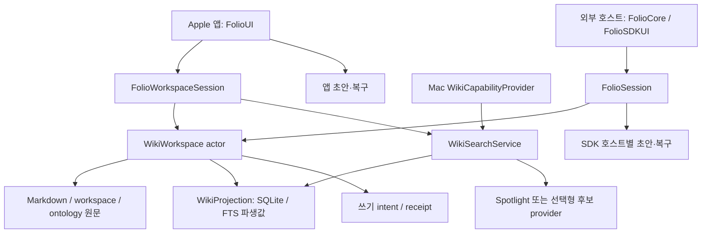
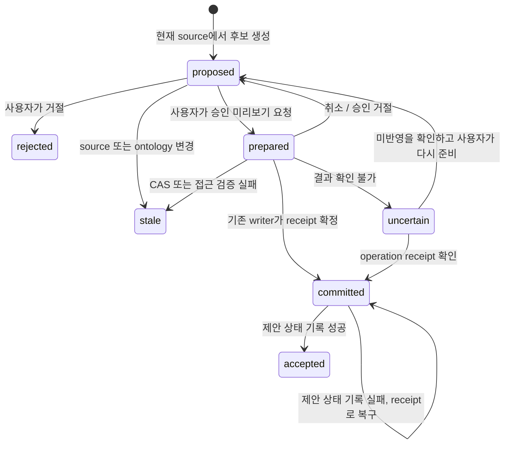

# Folio와 NVIDIA Auto Ontology 비교 및 발전 계획

작성: 2026-11-08 · 개정: 2026-11-08 · 상태: **재검토 후 단계별 구현**, [실행 기록](AUTO_ONTOLOGY_IMPLEMENTATION_REVIEW.md) 참조

## 1. 결정 요약

**Folio의 문서 원문 중심 구조를 기준 trunk로 유지하고, Auto Ontology의 후보 생성 → 검토 → 근거 확인 → 응답 가능성 판정이라는 설계 원칙을 문서 환경에 맞게 차용한다.** 서버 전체, SQL 생성 파이프라인, Postgres, NVIDIA NIM, 웹 UI를 Folio에 통째로 이식할 근거는 없다. 두 제품은 대상 데이터와 동작 경계가 다르다.

Folio의 가장 큰 기회는 이미 존재하는 Markdown, 관계, 원문 좌표, 검색 후보, 승인된 쓰기를 이용해 **사용자가 문서에서 근거를 찾고 연결을 검토할 수 있도록 만드는 것**이다. 먼저 검색의 실제 품질과 미해결 관계를 계측하고, 그 결과에 따라 검토 가능한 관계 제안을 선택적으로 추가한다. 모델을 사용하기 전에도 같은 원문을 열고, 변경을 검토하고, 안전하게 저장할 수 있어야 한다.

권고 순서:

1. **P0: 기준 고정과 안전한 정리.** 버전 없는 작업 트리의 기준을 확보하고, SDK 배포 권리와 기존 소비자를 확인한다. 제품 코드 삭제보다 재현 가능한 목록과 검증 기준이 먼저다.
2. **P1: 검색과 근거의 관찰 가능성.** 실제 앱 검색·SDK 검색·SEMI 검색의 다른 계약을 명시하고 평가용 문서와 질의를 만든다. 출처 확인, 부분 결과, 검색 불가, 검색 실패를 구별한다.
3. **P2: 관계 검토.** 명시된 링크/타입 관계의 유효성, 빠진 대상과 원문 근거를 보여준다. 부족한 관계를 제안하더라도 자동으로 원문에 쓰지 않는다.
4. **P3: 인용 근거 검증.** 선택된 원문 참조의 최신성·무결성·접근 가능성을 확인한다. 질문에 답할 수 있는지와 진실 여부는 별도 평가 없이는 판정하지 않는다. 이전의 자동 충분성 판정 계획은 철회한다.
5. **P4: 한국어·영어 의미 검색과 관계 제안 실험 구현.** 한국어·영어 후보 검색 뒤 공동 관련성 검사를 추가해 기존 오탐을 수정했다. 고정 합성 평가와 실제 Mac·iPhone UI를 검증했다. 이전 RSS·footprint의 실패 기록을 보존했다. 128 MiB는 Apple 제한이 아닌 근거가 부족한 내부 목표였음을 정정했고, 모델 중복과 반복 할당을 개선했다. 사용자의 후속 지시에 따라 장시간·반복 검증은 추가하지 않고 핵심 회귀·실기기 UI를 확인한다. 일반 자동 활성화는 계속 보류한다. [메모리 원인·결정·실기기 결과](SEMANTIC_MEMORY_INVESTIGATION.md), [실제 구현과 게이트 판정](SEMANTIC_SEARCH_IMPLEMENTATION.md)을 따른다.

**삭제 결정(최초 조사):** 정적 조사만으로 삭제 가능한 제품 파일은 확정하지 못했다. 후속 구현에서는 결함이 확인된 검색 task-group 경쟁 로직을 교체하고, 과거 manifest 11개가 서로 다른 목록임을 확인해 보존했다. 8절의 항목들은 제거·통합 **후보와 그 선행 조건**이다. 특히 초안 복구, 파일 관리, 전송, 라이선스 고지 및 공개 제품은 다른 프로젝트에 유사 코드가 없다는 이유로 제거하지 않는다.

**판정이 바뀌는 조건:** Folio가 실제로 기업 데이터베이스의 질의·수치 검증 제품으로 전환되고, 이에 대한 사용자·운영 예산·접근 제어 요구가 확인된다면 Auto Ontology를 별도 서비스로 연동하거나 그쪽을 해당 데이터 분석 영역의 기준 구현으로 채택하는 결정을 다시 검토한다. 이 문서는 그러한 수요나 사업 성과를 증명하지 않는다.

## 2. 조사 범위와 재현성

| 항목 | 기준 |
| --- | --- |
| Folio | `/Users/ax/repoGithub/Folio`의 2026-11-08 작업 트리. `main`에 아직 커밋이 없어 Git SHA가 없다. 추적·미추적·staged 변경이 함께 존재한다. |
| Folio 내용 식별 | `Package.swift`, `Package.resolved`, `README.md`, `Sources`, `Apps`, `MacApp`, `MacIntegration`, `Extensions`, `Tests`, `Vendor`, `Tools`, `script`의 파일 310개에 대해 경로와 각 파일 SHA-256을 정렬하여 계산한 집합 해시 `ef878c0551f5dc3e3282e40b70936221521e83fec88b32a8d1c52f641b2235d1`. `.build`와 `.DS_Store` 제외. 이 값은 Git commit이나 전체 저장소 해시가 아니다. Xcode 프로젝트와 문서·이미지는 범위 밖이다. |
| NVIDIA | [auto-ontology `c447003f72a822301e927196a4ecb5b597c308d5`](https://github.com/NVIDIA/auto-ontology/tree/c447003f72a822301e927196a4ecb5b597c308d5), 2026-11-06 커밋. 비교 링크는 이 revision에 고정한다. |
| 방법 | 패키지 선언, 진입 경로, 핵심 모델·검색·관계·쓰기·에이전트 표면, 테스트 파일과 프로젝트 문서 정적 조사. 구현에 근거한 비교와 제안을 구분했다. |
| 실행 | 두 프로젝트의 전체 빌드·테스트, NVIDIA 서버/모델·DB, 실기기 및 검색 벤치마크는 **이번 조사에서 실행하지 않았다**. 기존 문서의 과거 PASS를 현재 revision의 실행 증거로 전용하지 않는다. 이 행은 최초 조사 당시의 범위이며, 후속 구현의 실행 결과는 [실행 기록](AUTO_ONTOLOGY_IMPLEMENTATION_REVIEW.md)을 따른다. |
| 깊이의 한계 | 모든 함수 본문을 1:1 대조한 전수 감사가 아니다. 아래의 핵심 사용 시나리오와 해당 경로의 함수에 초점을 맞췄다. 프런트엔드 각 화면, 모든 커넥터·테스트, Apple OS 동작과 NVIDIA의 실제 배포 보안은 별도 조사 대상이다. |

집합 해시 재계산 규칙: 각 파일에 대해 `path UTF-8 + NUL + SHA256(file bytes)`를 경로 오름차순으로 이어 붙인 뒤 SHA-256을 계산한다. 실제 프로젝트 보존 및 다음 작업 인계에는 Git commit이나 별도 불변 아카이브가 필요하다. 사용자의 기존 untracked 파일이나 index를 임의로 변경하지 않는다.

위 310개 집합은 최초 비교 시점의 고정 자료다. 후속 자원 최적화의 현재 소스·실행 파일 식별은 [최신 검증 manifest](Verification/semantic-memory-20261108/results.json)를 따른다. 두 manifest는 조사 범위가 달라 파일 수나 집합 해시를 직접 비교하지 않는다.

표의 **관찰**은 코드에서 확인한 사실이며 **제안**은 아직 구현·검증되지 않은 목표 상태다. 선언·README·과거 테스트 기록은 런타임 성공을 보장하지 않는다.

## 3. 프로젝트 수준 비교

| 비교 기준 | Folio: 관찰 | Auto Ontology: 관찰 | 해석 |
| --- | --- | --- | --- |
| 핵심 작업 | Mac/iPhone/iPad에서 Markdown을 열고 편집·검색·연결. 원문이 정본. [README](../README.md) | 관계형 데이터의 메타데이터에서 의미 계층을 만들고 질의한다. [README](https://github.com/NVIDIA/auto-ontology/blob/c447003f72a822301e927196a4ecb5b597c308d5/README.md) | 문서 지식 탐색과 데이터 분석은 연결되지만 같은 제품 계약이 아니다. |
| 배포 | SwiftPM 및 Apple 앱, 로컬/iCloud 파일, 선택형 Mac SEMI 연동. [패키지](../Package.swift) | Python 서비스·Next.js·Postgres/pgvector, Docker/Helm, 별도 MCP. | 서버 운영과 네트워크 의존성을 기본 앱에 강제할 이유가 없다. |
| 원본/파생 | Markdown·`_workspace.md`·선택적 `_ontology.md`가 원문. SQLite/Spotlight는 파생. | 데이터베이스와 카탈로그·의미 모델을 저장하며 모델/벡터 검색을 사용. | DB 컬럼 매핑과 문서의 범위·revision은 별도 모델로 다뤄야 한다. |
| 정체성 | workspace ID, document ID/path, section ID, SHA-256과 좌표. | term, column, SQL attribute, semantic relationship 및 데이터베이스 컨텍스트. | term을 곧바로 문서, FK를 곧바로 링크로 동치화하면 의미가 손실된다. |
| 검색 | 로컬 exact/FTS 페이지와 에이전트용 단건 검색의 Spotlight/선택형 provider 경로가 다르다. | 의미 인덱스의 label·DB·schema 필터, 후보 검색, 질문 분석·SQL 경로. | 후보 생성은 비슷하지만 결과 단위·완전성·실행 계약은 다르다. |
| 의미 제약 | 온톨로지의 type과 predicate의 from/to 제약, 명시 관계 상태. | 메타데이터에서 term·semantic FK·SQL attribute 생성과 관리. | Folio는 이미 온톨로지를 가진다. 자동 도출과 검토 수명주기는 별개 제안이다. |
| 에이전트 | Mac SEMI의 `wiki.*` read 및 승인 계획 기반 mutation. | 별도 읽기 중심 MCP와 인증된 API 쓰기 경로. [MCP 설명](https://github.com/NVIDIA/auto-ontology/blob/c447003f72a822301e927196a4ecb5b597c308d5/AGENTS.md) | 허용 목록·도구 설명·출처는 차용 가능. 기존 승인/CAS 경계는 유지한다. |
| 신뢰와 복구 | 충돌 거부, 초안, 쓰기 계획, operation receipt, 불확실 결과 확인. | 컴파일 취소, 후보 검증, SQL 검증·재구성, 인증·권한 경로. | Folio의 파일 변경 안전성을 약화하지 않으면서 검토 과정을 보완한다. |
| 라이선스 | `Vendor/README.md`는 KnowledgeKit 캡처본의 별도 라이선스 부재 및 공개 배포 전 검토 필요를 명시. | 저장소 [Apache-2.0](https://github.com/NVIDIA/auto-ontology/blob/c447003f72a822301e927196a4ecb5b597c308d5/LICENSE), 제3자 고지 별도. | 아이디어 참고와 코드 복사는 다르다. 코드 복사·배포 시 출처·고지·권리 검토가 별도로 필요하다. |

### 3.1 같은 사용자 과제로 비교

| 과제 | Folio 경로 | NVIDIA 경로 | 차이와 증거 수준 |
| --- | --- | --- | --- |
| 이름이 다른 대상을 찾기 | 문서 title/ID/path/aliases의 exact, FTS, 일부 경로의 추가 후보 → source 확인 | 질문에서 entity 추출 → term/column 후보 의미 검색 | Folio alias는 명시적이다. NVIDIA 후보는 의미 검색이므로 유사도가 동일성 증명이 아니다. 정적 코드 확인. |
| 관련 대상을 열기 | 문서 링크 또는 frontmatter 관계 → `WikiSnapshot.resolve` → 상태 표시 및 source 읽기 | term과 semantic FK 및 SQL attribute 기반 후보를 찾아 질의 경로 구성 | Folio의 관계는 문서의 선언이고 NVIDIA FK는 데이터 조인 의미다. |
| 근거가 최신인지 확인 | `WikiEvidenceReference`와 현재 파일 해시·섹션 범위를 재검증 | 쿼리 후보·SQL 검사 및 결과를 거쳐 답변에 SQL/단계 제공 | 소스 재검증이 동일 방식으로 구현되었다고 가정하지 않는다. |
| 변경 | 원문 revision 기반 prepare → 사용자 승인 → execute → 영수증 확인 | 의미 모델의 관리 API 경로; MCP는 읽기 중심 | 두 제품은 쓰기 표면과 권한 모델이 다르다. |
| 부족한 정보 | 커버리지·diagnostics·unresolved/invalid edge를 일부 결과에 노출 | 별도 entity coverage 파이프라인과 `check_answerable` 제공 | Folio의 coverageComplete는 스캔의 완전성이지 질문 답변 가능성 점수가 아니다. |

## 4. Folio 모듈 구조와 상태 권한

도식은 소유권을 설명하는 단순화이며 모든 동기화 경로를 나타내지 않는다.

| 모듈 | 관찰된 책임 / 실제 연결 | 이 분석의 결정 |
| --- | --- | --- |
| `FolioCore` | `FolioSession`의 SDK workspace·편집 대상·초안·저장·검색. 앱과 SDK의 공유 기반을 사용. | 유지. 앱의 `FolioUI`와 유사한 이름이 있다는 이유로 동일 구현으로 간주하지 않는다. |
| `FolioSDKUI` | SDK 호스트용 라이브러리·편집 UI. `FolioCore` 의존. | 유지. 외부 호스트 계약과 앱 UI의 사용자를 분리. |
| `FolioUI` | 앱 셸·창별 검색·문서·복구·iCloud·전송·스킬 UI. 실제 MacApp과 Xcode 프로젝트에서 사용. | 현재 삭제 불가. 책임 경계별 재검토. |
| `FolioKnowledge` | 파싱, 온톨로지, 관계 스냅샷, FTS와 ranking. `Vendor/KnowledgeKit`에서 포함. | 근거·관계 핵심. 원문/파생 경계를 보존. |
| `FolioKnowledgeApple` | 파일 coordination, 원문 쓰기, 검색 서비스, Spotlight 등 Apple I/O. | 단일 writer와 실패·복구 계약 보존. |
| `MacIntegration/FolioProvider` | SEMI에 검색/읽기/관계/상태/작업 조회와 승인 기반 mutation 노출. | 선택형 adapter로 유지. MCP와 동일 프로토콜이라고 부르지 않는다. |
| `FolioNearbyTransport` | 전송 계층. 앱은 직접 의존. | 온톨로지와 무관하다는 이유로 제거하지 않는다. |
| `FolioAgents` | 로컬 agent skill 및 호스트 CLI 관리. | 문서 지식 모델과 별도 관심사. 선택형 패키지화 가능성을 사용자 가치·설치 계약 확인 후 평가. |
| `FolioVaultImport` | 기존 vault의 스냅샷·변환 계획·검증·반영. | 원본 및 변환 계약을 확인하기 전 삭제 금지. |
| `FolioDevelopment` | 개발 빌드·번들·자산 명령 계획/실행. | 제품 런타임과 개발 도구를 분리하되 실제 shell/CLI 경로는 유지. |

## 5. Auto Ontology 모듈 구조

| 모듈 | 확인한 책임 | Folio에 차용할 것 / 보류할 것 |
| --- | --- | --- |
| `ingestion_service` | 소스 수집과 스케줄, 실행 이력·semantic scheduler. | 실행 단계·실패·취소 상태의 분리는 참고. DB 수집기를 그대로 들여오지 않는다. |
| `semantic/compile.py`, `pipeline.py` | 컴파일, 병렬 테이블 처리, 정해진 순서의 commit, 관계/SQL 속성 후속 단계. | 병렬 후보 생성과 순서가 고정된 반영의 분리를 참고. 지금 Folio에 LLM 컴파일러가 있다고 보지 않는다. |
| `semantic/term_extractor.py`, `semantic_fk.py` | term 후보 추출 및 데이터 기반 FK 후보 처리. | 제안에는 생성 근거와 대상 source revision을 붙인다. FK를 문서 관계로 그대로 변환하지 않는다. |
| `retrieval/data_access` | 검색 및 결과 변환, 의미 인덱스 질의, label과 데이터베이스 범위 제한. | 검색 후보의 출처·범위·제한을 명시. 데이터베이스 label 설계를 복사하지 않는다. |
| `retrieval/entity_coverage` | 질문에서 추출한 항목과 검색 후보의 커버리지 처리. | 질문에 대한 근거 부족을 표현하는 별도 결과. Folio의 스캔 커버리지와 분리. |
| `retrieval/text_to_sql` | 질문 분류·후보·SQL 구성·검사·수정·실행·응답을 상태 그래프로 연결. | 단계별 검증, 제한된 재시도, 실패 이유는 참고. SQL 기능 자체는 현재 비목표. |
| `server`, `frontend` | API, 인증·권한, 모델 관리 UI와 사용 경로. | 민감한 작업과 조회의 경계는 참고. Folio의 로컬 앱에 서버 운영을 강제하지 않는다. |
| `mcp` | OpenAPI에서 의미 중심 도구를 allow-list로 선택하며 별도 chat/readiness 경로가 있다. | 작고 목적이 분명한 에이전트 도구 표면. Folio SEMI와 프로토콜 차이를 유지. |

## 6. 함수 단위 비교와 구체적 관찰

아래 표의 연결은 **역할 비교**이며 함수가 동일 계약이라는 뜻이 아니다. NVIDIA 링크는 조사한 커밋에 고정된다.

| 시나리오 | Folio 함수와 관찰 | NVIDIA 함수와 관찰 | 결정 / 확인할 차이 |
| --- | --- | --- | --- |
| 원문/스키마 모델 구성 | [`WikiOntology.init(bytes:)`](../Vendor/KnowledgeKit/Sources/KnowledgeKit/WikiOntology.swift)에서 `kind`, type 집합, relation `from/to`를 검증하고 bytes의 해시를 보관한다. | [`run_semantic_compilation`](https://github.com/NVIDIA/auto-ontology/blob/c447003f72a822301e927196a4ecb5b597c308d5/auto_ontology/semantic/compile.py#L33)은 컴파일/임베딩 뒤 FK·SQL 속성·bridge 단계를 호출한다. | Folio ontology 파싱은 결정적 입력 검증이다. NVIDIA 컴파일은 후보 생성·외부 모델·DB가 포함되는 다단계 작업이다. Folio에 단계별 상태를 추가하려면 별도 계약이 필요하다. |
| 후보의 결정적 반영 | [`WikiProjection.apply`](../Vendor/KnowledgeKit/Sources/KnowledgeKit/WikiProjection.swift#L58)는 scan을 파생 projection에 반영한다. | [`compile_semantic_layer`](https://github.com/NVIDIA/auto-ontology/blob/c447003f72a822301e927196a4ecb5b597c308d5/auto_ontology/semantic/pipeline.py#L126)는 테이블 작업을 병렬화하고 정렬된 commit 순서를 조정한다. | scan 반영과 생성 결과의 사용자 승인 반영은 다르다. 나중에 제안 작업을 병렬화해도 원문 쓰기 순서·검증은 기존 writer가 소유한다. |
| 추론된 관계와 명시 관계 | [`WikiSnapshot.resolve`](../Vendor/KnowledgeKit/Sources/KnowledgeKit/WikiSnapshot.swift#L45)는 선언을 대상 문서에 연결하고 `valid`, `invalid`, `unresolved`를 계산한다. ontology 부재와 unavailable은 다르다. | [`resolve_semantic_fks`](https://github.com/NVIDIA/auto-ontology/blob/c447003f72a822301e927196a4ecb5b597c308d5/auto_ontology/semantic/semantic_fk.py#L91)는 컬럼 간 semantic FK 해소 경로다. | 문서 링크를 join 가능성으로 취급하지 않는다. 기존 명시 관계 상태와 모델 제안 상태를 별도로 저장·표시한다. |
| 텍스트 질의 | [`WikiSearchQuery.init`](../Vendor/KnowledgeKit/Sources/KnowledgeKit/WikiSearchRanking.swift#L7)은 길이와 NUL을 검사하고 literal FTS expression을 만든다. | [`search_semantic_index`](https://github.com/NVIDIA/auto-ontology/blob/c447003f72a822301e927196a4ecb5b597c308d5/auto_ontology/retrieval/data_access/semantic_search.py#L303)는 retriever에 label별 후보 요청 및 메타데이터 범위를 전달한다. | 질의 escape, 사용자 범위와 후보 상한을 보존한다. 의미 검색 후보가 파일 접근 권한을 넓혀서는 안 된다. |
| 순위 결합 | [`WikiSearchRanking.init`](../Vendor/KnowledgeKit/Sources/KnowledgeKit/WikiSearchRanking.swift#L32)은 exact, FTS, 선택된 후보의 순위를 합치고 exact 우선·경로/ordinal tie-break를 적용한다. | [`_hits_to_semantic_rows`](https://github.com/NVIDIA/auto-ontology/blob/c447003f72a822301e927196a4ecb5b597c308d5/auto_ontology/retrieval/data_access/semantic_search.py#L260)는 vector distance 순서의 후보에 label별 상한을 적용한다. | 유사도 값 자체를 정답 확률로 표기하지 않는다. Folio는 이미 순위 융합과 provenance가 있으므로 중복 구현하지 않는다. |
| 페이지 검색 | [`WikiProjection.searchPage`](../Vendor/KnowledgeKit/Sources/KnowledgeKit/WikiProjectionSearch.swift#L6)와 [`WikiWorkspace.localSearchPage`](../Vendor/KnowledgeKit/Sources/KnowledgeKitApple/WikiPagedSearch.swift#L8)는 local 후보의 cursor와 source epoch를 묶고 현재 source를 재검증한다. | `search_semantic_index`는 label별 `top_k` 후보 검색이며 동일한 문서 전체 pagination 계약이 아니다. | top-k 의미 후보를 기존의 전체 로컬 결과 총수에 합산해 완전하다고 표시하지 않는다. |
| 에이전트용 검색 | [`WikiSearchService.search`](../Vendor/KnowledgeKit/Sources/KnowledgeKitApple/WikiSearchService.swift#L19)는 로컬 후보 후 Spotlight 또는 주입된 provider 후보를 합치고 각 source를 읽어 검증한다. | [`get_coverage_response`](https://github.com/NVIDIA/auto-ontology/blob/c447003f72a822301e927196a4ecb5b597c308d5/auto_ontology/retrieval/entity_coverage/main.py#L86)는 질문 coverage graph를 실행한다. | 검색 결과와 질문에 충분한 근거인지는 다른 결과 타입이다. 현재 앱은 기본 service 생성 시 semantic provider를 주입하지 않는다. |
| 최신 근거 읽기 | [`WikiWorkspace.read(_:)`](../Vendor/KnowledgeKit/Sources/KnowledgeKitApple/WikiEvidenceReading.swift#L7)는 workspace ID, 파일 hash, 문서·section ID, range를 다시 확인한다. | [`SQLValidationAgent.execute`](https://github.com/NVIDIA/auto-ontology/blob/c447003f72a822301e927196a4ecb5b597c308d5/auto_ontology/retrieval/text_to_sql/agents/sql_parse_validation.py#L787)는 SQL 검증 경로다. | 검증 대상이 다르다. 인용 정확성은 원문 재읽기로, DB 질의는 SQL/데이터 실행 검증으로 확인한다. |
| 수정과 결과 확인 | [`prepareEdit`/`execute`/`operationStatus`](../Vendor/KnowledgeKit/Sources/KnowledgeKitApple/WikiWorkspace.swift#L153) 및 [`WikiCapabilityProvider`](../MacIntegration/Sources/FolioProvider/WikiCapabilityProvider.swift#L100)가 계획·승인·실행·receipt 경계를 유지한다. | [`route_sql_validation`](https://github.com/NVIDIA/auto-ontology/blob/c447003f72a822301e927196a4ecb5b597c308d5/auto_ontology/retrieval/text_to_sql/text_to_sql_graph.py#L85)은 검증 결과에 따라 SQL 재구성 또는 중단한다. | 쿼리 재작성은 파일 쓰기 재실행이 아니다. 불확실한 원문 쓰기는 자동 재시도하지 않는다. |
| 선택된 기능 노출 | [`WikiCapabilityContract.all`](../MacIntegration/Sources/FolioProvider/WikiCapabilityContract.swift#L33)과 `decode`가 schema 및 최상위 키 admission을 공유한다. | [`ToolSpec`/allow-list](https://github.com/NVIDIA/auto-ontology/blob/c447003f72a822301e927196a4ecb5b597c308d5/mcp/auto_ontology_mcp/tools.py#L43)가 선별된 read 도구를 정의한다. | 도구 증가는 사용자 작업과 권한 경계를 기준으로 한다. 스키마 적합성은 최상위 키 검사만으로 입증되지 않으므로 각 도메인 검사·호환 테스트가 필요하다. |
| 결과 정리 | [`EvidenceEnvelope`](../MacIntegration/Sources/FolioProvider/EvidenceEnvelope.swift)에는 revision·좌표·truncation·coverage·관계가 있으며 `atomicSnapshot = false`다. | SQL 구성·실행 이후 응답은 SQL과 단계 제공을 목표로 한다. [README](https://github.com/NVIDIA/auto-ontology/blob/c447003f72a822301e927196a4ecb5b597c308d5/README.md) | 현재 여러 원문 및 relation을 한 시점의 원자적 스냅샷이라고 주장하지 않는다. 인용 시 각 revision을 확인한다. |

### 6.1 검색 경로에서 놓치기 쉬운 차이

1. 앱의 [`WikiAppModel.search`](../Sources/FolioUI/WikiAppModel+Search.swift#L4)는 `service.searchPage`를 호출하고, 이 함수는 `localSearchPage`로 위임한다. SDK [`FolioSession.searchPage`](../Sources/FolioCore/FolioSession.swift#L231)도 local 경로다.
2. SEMI의 `wiki.search`는 [`WikiCapabilityProvider.performRead`](../MacIntegration/Sources/FolioProvider/WikiCapabilityProvider.swift#L40)에서 `service.search`를 호출한다. 이 경로만 선택형 semantic callback 또는 Spotlight 후보를 이용한다. [`FolioWorkspaceSession`](../Sources/FolioUI/FolioWorkspaceSession.swift#L125)의 현재 생성 경로에는 semantic callback이 없다. Spotlight를 자체 embedding 모델이라고 칭하지 않는다.
3. 기존 제한형 검색은 최대 32개 질의 term 및 FTS 후보 500개 제한을 사용한다. 페이지 검색은 이 제한형 경로와 별도다. [`WikiProjection.search`](../Vendor/KnowledgeKit/Sources/KnowledgeKit/WikiProjection.swift#L177), [`ftsCandidates`](../Vendor/KnowledgeKit/Sources/KnowledgeKit/WikiProjectionSearch.swift#L25).
4. **변경 전 관찰:** `WikiSearchService.search`의 task group에는 800ms timeout 경쟁이 있지만, structured task group은 취소된 자식 작업 종료를 기다린다. 따라서 외부 provider가 취소를 무시하면 **전체 응답이 800ms 이내에 끝난다고 보장할 수 없다**. 실제 영향은 취소 비협조 provider를 이용한 실행 검증이 필요하다. 변경 전 구현에서 provider 오류는 결과의 source 분류가 `.spotlight`로 기록되는 경로도 있어, 진단 정확성을 별도 점검한다. [구현](../Vendor/KnowledgeKit/Sources/KnowledgeKitApple/WikiSearchService.swift#L25)
5. **현재도 적용:** 검색 rank는 후보의 관련성 순위이지 문서 사실의 참·거짓이나 답변 가능성의 보증이 아니다. `coverageComplete`는 스캔과 검증의 완전성이지 recall 100%가 아니다.

## 7. 발전 방향: 문서 근거 중심 지식 계층

### 7.1 제품 원칙

- 사용자의 Markdown 원문을 정본으로 두고 SQLite, 검색 인덱스, 제안과 임베딩을 다시 만들 수 있는 파생물로 둔다.
- 사용자가 현재 선택한 workspace와 접근 범위 안에서만 수집·검색한다. 외부 모델에 본문을 보내는 기능은 명시적인 선택과 실제 전송 범위 표시가 선행되어야 한다.
- 선언된 사실, 시스템의 후보, 사용자가 승인한 변경, 실제 쓰기 영수증을 구별한다. LLM 점수는 검증이나 승인으로 바꾸지 않는다.
- 충돌·취소·계정 전환·원문 변경·부분 스캔·결과 미확인을 성공으로 합치지 않는다.
- 네이티브 오프라인 검색과 원문 편집을 기본 경로로 유지한다.

### 7.2 장기 설계 참고 — Target, 미구현

**재검토:** 아래 proposal/assessment 모델은 현재 구현 범위가 아니다. `supported`/`ambiguous`의 자동 의미 판정은 검색 결과만으로 구현하지 않는다. 현재 P3는 9절의 인용 검증으로 축소·구체화했다.

`WikiRelation`을 대체하지 않고 추가 계층으로 설계한다. 아래 이름과 직렬화 형식은 구현 전에 호환성 검토가 필요한 초안이다.

| 객체 | 최소 필드 | 권한과 수명 |
| --- | --- | --- |
| `EvidenceRef` | workspace ID, document ID, section ID, relative path, source SHA-256, range, excerpt digest | 기존 `WikiEvidenceReference`를 우선 재사용. 매번 원문에서 검증. 경로와 위치는 이동 시 무효화 또는 재해소. |
| `RelationProposal` | proposal ID, workspace ID, source/target ID, predicate, source/target revision, ontology revision 또는 명시적 absent, evidence refs, producer ID/version, createdAt, status | 파생 저장소 소유. 원문을 변경하지 않는다. 동일 입력·모델/규칙 버전의 중복을 명시적으로 처리. |
| `ProposalStatus` | `proposed`, `accepted`, `rejected`, `stale`, `withdrawn` | `accepted`는 사용자가 승인한 쓰기 receipt를 확인한 뒤에만 도달. 상태 저장 실패와 원문 반영 성공을 별도로 표현. |
| `EvidenceAssessment` | question, evidence refs, `supported`/`insufficient`/`ambiguous`/`unavailable`, completeness diagnostics, method/version | 질의별 일시 결과. `supported`도 문장 진실의 보증이 아님. 근거가 변경되면 stale. |
| `OperationOutcome` | operation ID, `prepared`/`committed`/`notObserved`/`uncertain`/`rejected`, receipt 또는 오류 | 기존 쓰기 계약 재사용. 새 시스템은 기존 receipt를 조회하고 불확실 쓰기를 반복하지 않는다. |

**인증 의미:** Folio에 NVIDIA와 같은 기업별 인증 절차가 이미 존재한다고 가정하지 않는다. 초기에는 사용자가 특정 제안을 승인해 원문에 반영했는지만 기록한다. 조직 차원의 인증자·권한·취소 이력이 필요한지는 실제 사용자 요구가 확인된 후 결정한다. SKOS의 개념/별칭/관계와 PROV-O의 출처 표현은 상호운용성 설계의 참고 자료이지, 현재 Folio가 RDF/OWL 호환이라는 주장이 아니다. [W3C SKOS](https://www.w3.org/TR/skos-reference/), [W3C PROV-O](https://www.w3.org/TR/prov-o/)

### 7.3 장기 제안 관계의 상태 전이와 쓰기 (현 구현 범위 밖)

이 도식은 Target이다. `committed`는 원문이 반영됐다는 writer의 결과이며 `accepted`는 그 사실을 제안 저장소에 반영한 상태다. 준비 후 source 또는 ontology가 바뀌면 승인 전/실행 시 재검증한다. 취소 뒤에도 실행 결과가 확정되지 않았다면 `uncertain`을 보존한다. 동일 operation ID와 idempotency를 기존 writer 의미에 맞춰 다루며, 사용자가 승인한 미리보기와 다른 patch를 실행하지 않는다.

### 7.4 장기 생산자·소비자 계약 초안 (현재 P3 계약은 9절)

| ID | 생산자 → 소비자 | 입력과 성공 | 실패·복구 |
| --- | --- | --- | --- |
| C1 | `WikiWorkspace` → 기존/새 검색 | 선택된 workspace, query/filter, source epoch → 검증된 `WikiEvidenceReference`와 범위·truncation | 파일 변경·권한 상실·계정 전환은 오류 또는 불완전 상태. 자동으로 다른 workspace를 열지 않는다. |
| C2 | proposal generator → review UI | source/target/ontology revision과 근거가 있는 후보만 생성 | 취소 시 완료된 부분은 `proposed` 또는 명시적 partial. 접근 불가·모델 실패는 빈 성공이 아니다. |
| C3 | review UI → 기존 writer | 사용자의 정확한 patch 승인, operation ID, expected revisions | source mismatch는 stale. receipt 미확인은 uncertain. 기존 `operationStatus`로 확인. |
| C4 | evidence assessor → 사용자/agent | 검색 결과 및 각 근거의 현재 재검증 → 상태와 진단 | incomplete scan과 no hits, provider unavailable, 근거 충돌을 분리. 질의에 대한 완전성은 측정 전 단정하지 않는다. |
| C5 | 선택형 provider → 검색 | 명시적으로 허용한 workspace/내용, provider/model/version, bounded candidates | 취소·시간 제한·전송 실패 시 local 결과와 degraded 상태를 분리. 중단이 불가능하면 별도 격리 설계와 자원 상한 검증. |

## 8. 불필요한 부분의 제거·축소 계획

정적 참조가 없다는 것만으로 public API, 반사 호출, 앱 배포 경로, 사용자 데이터의 미사용을 증명할 수 없다. 아래 항목들은 **검증을 통과한 후 제거 또는 축소**한다. 크기가 크거나 Auto Ontology에 없다는 사실은 제거 근거가 아니다.

| ID / 우선순위 | 후보와 현재 근거 | 실제 조치 제안 | 제거 전에 필요한 증거 / 되돌리기 |
| --- | --- | --- | --- |
| R1 / P0 | `docs/SOURCE_SHA256*` 11개와 `docs/History` 등 과거 증거. 역할·인용 관계는 아직 전수 확인하지 않았다. | 문서·manifest·복구 지침에서 참조 그래프를 만들고 기준 이력과 중복 여부를 분류. 중복은 삭제보다 먼저 보존 위치/인덱스 통합을 검토. | 모든 링크 및 외부 참조·감사 목적 확인, 원본 checksum 백업, 작성자/사용자 의도 확인. 원본 복원 가능해야 함. |
| R2 / P1 | `WikiProjection.search` 제한형 검색의 `legacyTermLimit`/`legacyLimit`와 local page 경로가 공존한다. 실제 SEMI는 전자를 사용한다. | 검색 query/FTS/순위의 공통 순수 로직은 이미 공유 중이므로, 남은 차이를 계약 표로 문서화하고 중복이 실측될 때만 내부 로직 통합. 32 term/500 후보를 임의 변경하지 않는다. | SEMI·SDK·앱·외부 `FolioKnowledge` 소비자 인벤토리, 32/33 term·500/501 후보·tie·truncation 및 source 변경 fixture, 이전 결과 대비 diff. 외부 API 유지 또는 명시적 migration. |
| R3 / P1 | `FolioCloudIdentity`라는 이름이 Core와 UI 양쪽에 있다. 전자는 계정 ID 관리, 후자는 앱 opening/account 상태에서 사용한다. | 구조·기능을 비교하여 공통 순수 로직만 증명될 때 추출. 이름이 같다는 이유로 한쪽 제거 금지. | Keychain/계정 식별·세대·복구 경로·기존 데이터와 실기기 계정 전환 회귀, 저장 포맷 보존. |
| R4 / P2 | `FolioUI`와 `FolioSDKUI`는 모두 UI이지만 실제 호출자·상태 소유자가 다르다. `FolioUI`는 앱이 사용한다. | 공통으로 동일한 view와 계약이 실증되는 부분만 추출. 앱 UI 전체의 SDK UI 대체는 제안하지 않는다. | accessibility·초안·저장·멀티윈도·iCloud 경로 비교, 양 앱 타깃과 독립 SDK 호스트 검증. |
| R5 / P2 | `SkillCatalog`의 `~/.codex/skills` 읽기 전용 호환 경로와 앱의 legacy 초안 열람이 있다. [SkillCatalog](../Sources/FolioAgents/SkillCatalog.swift#L15), [복구 UI](../Sources/FolioUI/WikiRecoverySections.swift#L23). | 실제 지원 정책과 사용자 데이터 존재 여부를 확인한 뒤 폐기 시점·내보내기·이관 도구를 설계. 현재는 보존. | 외부 공식 경로와 기존 설치, 누락되는 초안/수정 파일의 복구 가능성, 호환 기간, migration/rollback. |
| R6 / P3 | `storeDerivedValue` 등 공개 파생값 API에 현재 저장소 내 직접 호출이 검색되지 않았다. [`WikiProjection`](../Vendor/KnowledgeKit/Sources/KnowledgeKit/WikiProjection.swift#L197). | 공개 제품 외부 소비와 향후 provider 계약을 조사. 미사용으로 확정하고 버전 정책이 허용할 때만 deprecate → 제거. | 외부 검색만으로 증명 불가. API 소비자 조사·버전 정책·컴파일 fixture·마이그레이션 후 major 변경. |
| R7 / P3 | Agent/개발/import 도구는 문서 검색에 필수는 아니지만 각각 실제 CLI와 앱 기능이 존재한다. | 앱의 제품 범위와 사용자별 사용량 확인 후 별도 선택 패키지/배포를 검토. 자동 제거하지 않는다. | 사용자의 기능 접근 유지, SwiftPM 제품 및 CLI 호환, 설치 및 문서 변경, rollback. |
| R8 / P0 | `Vendor/KnowledgeKit`의 캡처본은 별도 license가 없었다고 고지한다. | 권리·배포 허가를 확인하고 정본/수정 및 재배포 범위를 문서화한다. | 권리 확인 전 공개 SDK 배포 여부를 결정할 근거가 부족하다. 이것은 코드 중복 제거 작업이 아니다. |

`.build`, `build`, 사용자 자료함, 초안, transfer receipt, iCloud 파일, 제3자 라이선스 파일은 정리 후보로 자동 분류하지 않는다. 사용자 데이터와 과거 증거 파일은 보존한다. 후속 정리·구현 내역은 실행 기록에서 확인한다.

## 9. 단계별 실행 명세

소요 기간은 팀 규모와 작업량이 확정되지 않아 산정하지 않았다. 검색의 합성 fixture 측정은 후속 실행 기록에 있다. 아래 단계는 재검토된 실행 범위다. 완료·실험 게이트·외부 근거 미확인을 구별한 실제 결과는 실행 기록을 따른다.

### P0 — 재현성과 정리 기준

**목표:** 현재 코드와 사용자 데이터를 안전하게 식별하고 이후 변경을 비교 가능하게 한다.

- `git status`, staged/untracked 목록과 실제 파일 manifest를 보존하고 사용자가 선택한 방식으로 불변 기준을 만든다. 임의 commit이나 기존 index 변경을 하지 않는다.
- `Package.swift`, `MacApp`, `MacIntegration`, Xcode 프로젝트, `Examples`, CLI, 공개 API의 생산자/소비자 표를 완성한다.
- R1/R8의 문서 참조 및 사용 권리를 확인한다. 최종 판단 전 실제 삭제나 공개 배포를 하지 않는다.
- **완료 기준 P0-1:** 재현 가능한 기준과 작업 전후 비교 방법을 기록한다. **P0-2:** 보호할 원문·초안·receipt·공개 계약과 삭제 불가 항목을 목록화한다.

### P1 — 검색 평가와 정확한 상태

**대상 파일:** `WikiSearchService.swift`, `WikiPagedSearch.swift`, `WikiProjectionSearch.swift`, `WikiSearchRanking.swift`, `WikiAppModel+Search.swift`, `FolioSession.swift`, `WikiCapabilityProvider.swift`, 관련 Tests. 실제 수정 파일은 구현 시 확인한다.

1. 합성 문서 corpus에 한국어·영어·별칭·동음이의·경로 이동·빈 결과·불완전 scan·오래된 원문을 포함하고 질문별 기대 section과 금지 결과를 기록한다. 실제 개인 문서는 수집하지 않는다.
2. 앱/SDK local page와 SEMI 검색을 같은 corpus에서 별도로 평가한다. Recall@10, MRR@10, 관련 문서 없는 질의의 잘못된 양성, 결과 coverage, source 검증 실패, p50/p95 지연을 같은 조건에서 기록한다. 샘플 크기와 결과 개수를 함께 공개한다. 초기 값이 없으므로 개선율·시간을 임의 보장하지 않는다.
3. 협조적/비협조적 취소 provider, 실패 및 늦은 응답을 재현해 timeout 주장과 source 진단을 검사한다. 필요하면 provider가 중단되지 않아도 반환할 수 있는 수명 관리 방식을 설계하고 작업 수·메모리 상한을 확인한다.
4. local 페이지 total과 외부 top-k를 섞지 않고 결과 출처, 오류·불완전·timeout 상태를 사용자와 agent 계약에서 정의한다.
5. R2의 공통화는 이 비교가 행동 보존을 입증한 범위에서만 수행한다.

**완료 기준:** 검색 경로별 gold fixture 재현, 변경 전후 관련성·지연·오류 지표와 confidence 범위를 기록, cursor/source mismatch 및 각 오류가 조용한 성공으로 표시되지 않음. 기준이 미달하면 의미 검색 추가 전에 원인을 먼저 고친다. 신뢰 구간은 표본이 허용할 때 보고하며 소표본을 통계적 결론으로 포장하지 않는다.

### P2 — 명시 관계 진단과 검토 UI

**대상 파일:** `WikiSnapshot.swift`, `SourceTypes.swift`, `WikiRelationsView.swift`, `WikiCapabilityProvider.swift` 및 관계 테스트.

1. 현재 valid/invalid/unresolved 관계를 source, 선언 위치, target, ontology revision, 사유와 함께 검토할 수 있도록 데이터 흐름을 정리한다. UI에 이미 표시되는 범위는 구현 전에 확인하고 중복 화면을 만들지 않는다.
2. 사용자 요청 시 원문 해당 선언을 열고 변경 계획을 표시한다. 우선은 사람이 직접 관계를 추가·수정하는 경로를 확인한다.
3. 기존 `wiki.add_relation`/`WikiWorkspace.prepareEdit`의 revision 검증, 승인, CAS, receipt를 재사용한다. 무효한 type 또는 없는 target에 대한 정책을 명시하고 현행 동작과 변경을 구별한다.
4. 자동 생성이 없어도 다음 테스트가 통과해야 한다: 대상 문서 없음, 중복 ID, ontology unavailable/absent, 타입 제약 위반, 상대 링크 이동, 생성 후 양쪽 문서 변경, 승인 후 충돌, 취소 및 uncertain receipt.

**완료 기준:** 관계마다 출처와 상태가 정확히 보이고 오래된 미리보기로 원문을 덮어쓰지 않는다. 기존 원문·관계 포맷과 승인 경로는 유지한다.

### P3 — 인용 근거 검증 (재검토로 수정)

**목표:** 선택한 근거를 현재 원문에서 다시 확인하고, current / changed / invalid / unavailable을 요청 순서대로 반환한다. 인용 검증은 질문 답변 가능성·진실 검증이 아니다.

1. `WikiWorkspace.verifyEvidence`와 읽기 전용 `wiki.verify_evidence`를 통해 최대 100개 참조를 검증한다. 빈 참조 배열은 `allCurrent = false`이며 stale 본문을 반환하지 않는다.
2. 기존 `read`의 workspace ID, 원문 revision, section/range, excerpt digest 검증을 재사용한다. 접근 admission 실패와 취소는 throw한다. 개별 참조의 문제는 상태와 진단으로 남긴다.
3. 여러 파일을 하나의 원자적 스냅샷으로 표시하지 않는다. 새로운 응답은 `atomicSnapshot = false`를 명시한다.
4. 현재·변경·위조된 digest·삭제된 파일·초과 입력·닫힌 workspace와 실제 provider 요청의 정상/실패를 검사한다.

**완료 기준:** 실제 원문 I/O와 provider 통합 테스트로 결과와 무변경을 확인한다. 의미적 충분성·상충 사실 자동 판정 및 답변 생성은 별도 품질 평가가 필요한 후속 범위다.

### P4 — 조건부 의미 검색·관계 제안 실험 (후속 구현 기록 있음)

**현재 상태:** [현재 실행 문서](SEMANTIC_SEARCH_IMPLEMENTATION.md)에 다국어 모델·기각 정책·별도 파생 캐시·제안 저장·승인·영수증 복구·실기기 검증과 남은 게이트를 기록했다. 아래 조건은 도입 검토 기준이며, 기본 자동 활성화 완료를 뜻하지 않는다.

**진입 조건:** P1에서 exact/FTS/alias가 해결하지 못한 반복 가능한 사용자 질의가 있고 P2의 검토 및 P3의 인용 검증 계약이 통과해야 한다. 합성 질의의 누락만으로 실사용 모델 수요가 검증됐다고 판단하지 않는다.

- 오프라인 우선 기준으로 local provider와 외부 provider의 정확도, 모델 크기, 기기별 메모리·배터리, 최초 인덱싱·증분 갱신 시간, 개인정보 이동, 운영비를 비교한다. 실측 전 특정 provider를 확정하지 않는다.
- 인덱스 key는 workspace identity, document/section identity, source revision, provider/model/version 및 필요한 전처리 버전을 포함한다. source 변경·삭제·이동·계정 전환에 대한 무효화와 rebuild를 시험한다.
- proposal 생성은 기존 관계 선언과 분리된 저장소에 쓰고, 원문을 자동 수정하지 않는다. 승인 시 C3의 쓰기 경계를 거친다.
- 품질 수용 목표는 P1의 baseline을 측정한 다음 팀이 사전에 정한다. 잘못된 관계 승인 위험, 편향, prompt injection, 개인정보 유출, 모델 미응답과 취소를 부정 fixture에 포함한다.
- **중단 기준:** baseline 대비 유의미한 품질 개선이 재현되지 않거나, 사용자가 이해할 수 없는 데이터 전송이 필요하거나, 안전한 중단·삭제·복구를 보장할 수 없으면 기능을 배포하지 않는다.

## 10. 검증 계획과 인수 fixture

| ID | 입력 / 조작 | 기대 결과 | 단계 |
| --- | --- | --- | --- |
| T01 | alias가 명시된 동일 문서 검색 | 정확한 문서·section과 실제 provenance. 검색 후 원문 변경 시 stale 감지. | P1 |
| T02 | 32/33 terms, 500/501 FTS 후보 | 제한형과 local page의 기존 계약 차이를 기록. 전체 건수와 top-k를 혼동하지 않음. | P1 |
| T03 | 검색 1페이지 후 원문·ontology·filter 변경 | 기존 cursor 거부 또는 명시된 재검색. 서로 다른 결과 epoch를 합치지 않음. | P1 |
| T04 | provider 오류, timeout, 취소 무시, 늦은 반환 | local 결과와 degraded 상태의 정책대로 동작. 실제 elapsed time·살아 있는 작업 수 확인. | P1 |
| T05 | 중복 ID, 없는 target, 제약 위반, ontology unavailable | 각각의 진단과 invalid/unresolved를 구별하고 원문 변경 없음. | P2 |
| T06 | 제안 미리보기 뒤 source/target/ontology 변경 | stale, 새 미리보기 요구. 승인한 patch 외 변경 없음. | P2/P4 |
| T07 | 쓰기 반영 뒤 응답 손실 | `uncertain` → receipt 조회. 동일 변경 자동 재실행 없음. | P2/P4 |
| T08 | 검색 결과 일부가 권한 상실/구문 오류 | partial coverage와 진단을 보여줌. no match나 완전 성공으로 표시하지 않음. | P1/P3 |
| T09 | 빈 참조 / 오래된 참조 / 잘못된 digest / 삭제된 원문 | allCurrent=false / changed / invalid / unavailable. 진실·답변 가능성을 추론하지 않음. | P3 |
| T10 | account/workspace 전환 중 인덱스 생성과 응답 도착 | 이전 범위 후보를 새 workspace에 게시하지 않음. 이전 데이터/초안 보존. | P4 |
| T11 | 사용자 거절·취소·정상 승인 | 제안과 실제 원문/receipt 상태가 구분되고 승인 없이는 파일 수정 없음. | P2/P4 |
| T12 | 외부 소비자가 기존 공개 API 사용 | 지원하는 빌드 및 결과 계약 유지 또는 문서화된 migration. | R2/R6 |

검증 계층은 순수 모델 단위 → 임시 디렉터리의 실제 parser/SQLite/파일 CAS 통합 → 독립 SDK host → Mac/iOS 앱 빌드 → 해당 기능의 격리 runtime → 필요한 경우 실제 iCloud 계정/기기 순서로 확장한다. mock 계정 성공과 실기기 결과를 혼동하지 않는다. 접근성 검증은 실제 VoiceOver 및 큰 글자 설정을 별도로 기록한다. 성능 결과에는 코퍼스 규모, 기기·OS, 냉/온 캐시, 반복 수를 명시한다.

## 11. 의존성·위험·되돌리기

| 위험 | 발생 조건 | 대응 / 중단 조건 |
| --- | --- | --- |
| 원문 유실 또는 오래된 승인 | 파일이 검토 뒤 외부 변경됨 | source revision/CAS·preview·receipt 유지. 불일치 시 새 검토. |
| 잘못된 확신 | 임베딩 유사도 또는 검색 성공을 사실 인증으로 표현 | 결과 출처·coverage·근거 구간과 평가된 한계 표시. 답변 불가 상태 유지. |
| 다른 계정/자료함 오염 | 같은 ID의 여러 위치 또는 계정, 작업 중 전환 | 기존 location/account/workspace scope 및 generation 유지, 늦은 결과 폐기. |
| 데이터 외부 전송 | 원격 임베딩/LLM에 개인 문서 제공 | 기본 로컬, 명시적 선택·전송 범위 표시 및 끄기/삭제 경로. 미충족 시 도입 중단. |
| 외부 API 중단 | 공개 `FolioKnowledge` 또는 CLI 제거 | 소비자 조사·버전 정책·컴파일 fixture·폐기 기간. 판단 불가 시 보존. |
| 파생 데이터의 오래됨 | source 이동·수정·ontology 변경·모델 교체 | revision/version key와 무효화, rebuild. 원문은 절대 파생값으로 덮지 않음. |
| 법적/배포 불확실성 | KnowledgeKit 원본 license 부재 또는 NVIDIA 코드 복사 | 권리와 고지 확인 후 결정. 현 분석은 법적 자문이나 배포 허가가 아니다. |
| 성능 저하 | 전체 스캔/재임베딩 또는 provider가 취소에 응답하지 않음 | P1 baseline, 작업 상한·증분 처리·실측 회귀. 기준 미달 시 기능 끄고 기존 local 경로 유지. |

롤백은 새 파생 인덱스·제안 기능을 비활성화하고 기존 원문/초안/receipt를 유지하는 방식으로 설계한다. 이미 사용자가 승인해 원문에 기록한 변경은 기능 롤백이 자동으로 되돌리지 않는다. 원문을 되돌리려면 현재 revision을 확인하고 별도의 명시적 편집을 준비한다.

## 12. 리서치 출처와 추가 확인 과제

- [NVIDIA Auto Ontology README, 고정 revision](https://github.com/NVIDIA/auto-ontology/blob/c447003f72a822301e927196a4ecb5b597c308d5/README.md): 제품 목적, 구성, 생성·검토·질의 흐름.
- [NVIDIA semantic compilation](https://github.com/NVIDIA/auto-ontology/blob/c447003f72a822301e927196a4ecb5b597c308d5/auto_ontology/semantic/compile.py), [parallel pipeline](https://github.com/NVIDIA/auto-ontology/blob/c447003f72a822301e927196a4ecb5b597c308d5/auto_ontology/semantic/pipeline.py), [semantic search](https://github.com/NVIDIA/auto-ontology/blob/c447003f72a822301e927196a4ecb5b597c308d5/auto_ontology/retrieval/data_access/semantic_search.py): 실제 단계와 후보 검색.
- [NVIDIA MCP allow-list](https://github.com/NVIDIA/auto-ontology/blob/c447003f72a822301e927196a4ecb5b597c308d5/mcp/auto_ontology_mcp/tools.py), [NVIDIA agent entry point](https://github.com/NVIDIA/auto-ontology/blob/c447003f72a822301e927196a4ecb5b597c308d5/AGENTS.md): 도구 노출과 쓰기 경계.
- [SQLite FTS5](https://www.sqlite.org/fts5.html): 검색 문법, tokenizer, bm25의 1차 문서. 한국어 질의 품질은 문서상 기능 존재가 아니라 Folio corpus로 별도 평가한다.
- [W3C SKOS Reference](https://www.w3.org/TR/skos-reference/), [W3C PROV-O](https://www.w3.org/TR/prov-o/): 개념 관계 및 출처 교환을 위한 참조 모델. 채택은 별도 결정.
- Folio의 [README](../README.md), [SDK 계약](SWIFTPM_SDK.md), [Vendor 고지](../Vendor/README.md), [기존 검증 이력](IMPLEMENTATION_STATUS.md): 구현 방향과 과거 기록. 코드는 본문 링크로 직접 확인한다.

추가 조사 순서: (1) Folio 공개 SDK 및 앱 외부 소비자와 권리 확인, (2) 사용자 검색 실패 사례와 평가 corpus, (3) 실제 관계 검토 UI의 표시 범위, (4) NVIDIA의 인증·권한·데이터 배포 경로와 정식 환경 실행, (5) 모델별 기기 성능과 개인정보 영향. 이 자료가 없으므로 대규모 코드 삭제, 자동 생성 관계의 원문 반영, 서버 제품 도입을 완료된 결정으로 표시하지 않는다.
