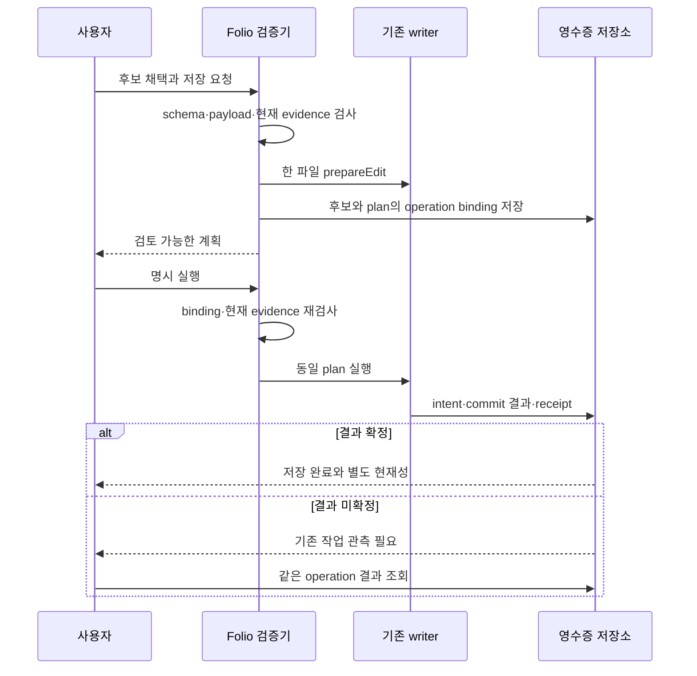

# Folio 온톨로지·정확도 고도화 구현 명세

작성일은 **2026-11-28, Asia/Seoul**이다. 상태는 **O1·O2·O3 구현, O4·O5 Target**이다. O3에는 수동 주장 저장·직접 조회와 주입형 추출 provider 계약·호스트 검증이 포함된다. 실제 모델 backend는 설정하지 않았다. 현재 코드와 온톨로지 비교 연구(로컬 보관: `docs/Research/folio-ontology-research-20261128.md`)를 대조해 구현 순서를 정했다. 현재 핵심 소스의 공개 배포 범위는 [릴리스 문서](RELEASE.md)에 둔다.

이 문서는 O1–O5의 실행 정본이다. 외부 프로젝트의 상세 비교는 위 연구에, 기존 P0–P7의 역사와 현재 원문 계약은 [지식 플랫폼 계획](KNOWLEDGE_PLATFORM_IMPLEMENTATION.md)에 둔다. 아래에서 O1–O3는 현재 구현이고 O4·O5는 후속 목표다. 구현된 주장 계약과 한계는 14절에 정리한다.

현재 핵심 제품 범위의 결함 수정과 최신 자동 회귀·실사용 판정은 최종 점검(로컬 보관: `docs/Verification/core-completion-20261128.md`)에 모았다. 아래의 단계별 검증 수와 과거 산출물은 해당 단계의 이력이다.

## 0. RAG·온톨로지 설계 재검토 · 2026-11-28

**온톨로지는 지식의 의미·유형·관계·제약을 정의하는 모델이고, RAG는 외부 정보를 가져와 생성 모델에 제공하는 처리 방식이다.** 지식 그래프는 그 모델에 따른 실제 개체·관계·사실을 표현할 수 있으며 graph DB는 저장 선택지다. 이 개념들을 하나의 제품이나 대체 기술로 합치지 않는다. 온톨로지 자체가 모든 원문 내용을 보유하거나 모든 주장의 진실을 보증하지도 않는다. [OWL 2 Primer](https://www.w3.org/TR/owl2-primer/) · [Palantir 핵심 개념](https://www.palantir.com/docs/foundry/ontology/core-concepts)

Folio의 현재 `WikiKnowledgeAnswer`는 원문 인용 결과다. 기본 생성 모델이 없으므로 현재 전체를 생성형 RAG 제품으로 부르는 것은 부정확하다. O2는 개념명·별칭·등장 위치를 연결하고 O3는 검토한 주장·조건·단위·판본을 해당 원문에 연결한다. 이 모델은 형식 추론이 가능한 완성된 온톨로지와 구별한다. 주장 사이의 관계 탐색과 생성 설명은 O4·O5의 후속 목표다.

### 최신 자료가 실제로 지지하는 내용

| 원 자료 | 확인한 내용과 한계 | 설계 결정 |
| --- | --- | --- |
| [Palantir Why Ontology](https://www.palantir.com/docs/foundry/ontology/why-ontology) · 조사일 문서 | 문서 중심 RAG를 넘어 데이터·로직·행동을 공통 의미·권한 아래 도구로 제공한다. | 사용자·에이전트가 같은 typed 조회·저장 계약을 사용한다. 범용 대화 생성을 제품의 중심으로 두지 않는다. |
| [Palantir OAG](https://www.palantir.com/docs/foundry/ontology/ontology-augmented-generation) · 조사일 문서 | 온톨로지를 사용하면서 검색도 다룬다. 전체 문맥이 충분히 작으면 semantic search 없이 시작하도록 권고한다. | 모든 질문에 embedding·RRF·생성을 강제하는 고정 파이프라인을 만들지 않는다. |
| [Anthropic, Components of agent memory](https://www.anthropic.com/research/components-of-agent-memory) · **11월 6일** | wiki와 원문 검색을 결합한 실험, 단일 문서 검색으로 충분한 사례, wiki의 누락·갱신 비용을 함께 보고한다. 특정 corpus의 관찰이며 Folio 실측은 아니다. | 검토한 개념·주장을 축적해 재사용하되 원본 조회를 남긴다. 소스별 쓰기와 정확한 인용을 유지한다. |
| [AutoOntic](https://arxiv.org/html/2611.15467v1) · **11월 11일 사전 공개** | 유형 계층과 domain/range 제약을 유도해 KG 구축·검색을 개선한다. 자동 유도 결과의 정확성·자료 보존을 평가하며 검색 폐기를 입증하지 않는다. | 이름만 연결한 그래프를 온톨로지 완성으로 부르지 않는다. 실제 분야·관계 제약을 단계적으로 추가한다. |
| [CoRA-Bench](https://arxiv.org/abs/2611.10238) · **11월 6일 사전 공개** | 같은 token 예산에서도 근거 종류와 평가 항목에 따라 문맥 선택 방법의 순위가 달라진다. | 장문 전체 입력·키워드·dense 중 하나가 항상 최선이라고 가정하지 않는다. 필요한 원문 보존을 비교한다. |
| [Karpathy LLM Wiki](https://gist.github.com/karpathy/442a6bf555914893e9891c11519de94f) · 4월 4일 아이디어 문서 | 원문에서 재사용 가능한 wiki를 미리 축적하는 패턴이다. 검증된 범용 정확도 연구나 형식 온톨로지 명세는 아니다. | Concept·Assertion의 지속 저장에 참고하되, 생성 요약을 원본 사실의 새 권위로 승격하지 않는다. |

### 이번 작업에 적용하는 수정

1. **이미 아는 개념은 직접 조회한다.** `readKnowledgeConcept`는 등록한 의미·분야·채택한 등장 위치를 모델 없이 제공한다. 원문 조회와 함께 사용하면 에이전트도 재검색을 반복할 필요가 없다.
2. **필요한 자료를 모를 때 검색한다.** 키워드를 기본으로 유지하고 개념 확장·뜻 검색을 선택적으로 결합한다. 원문 검색은 아직 정리하지 않은 내용과 새 질문의 누락을 보완한다.
3. **선택한 범위가 작으면 그 범위를 직접 읽는다.** 기존 typed 원문·근거 API를 사용한다. 향후 생성 adapter의 전체 문맥 입력은 실제 길이와 현재 접근 검사를 통과한 범위에 한정한다.
4. **생성은 선택형 소비 기능이다.** O5는 설명이 필요한 경우의 adapter다. O3의 근거·저장 계약이 선행 조건이며 O4의 관계 탐색은 필수 선행 조건이 아니다.
5. **정확한 정보를 얻기 위한 단계 수를 측정한다.** 알려진 개념 조회, 모르는 근거 찾기, 원문 확인, 명시 저장을 대표 흐름으로 둔다. 같은 정보를 다시 추출·요약하거나 내부 관리 화면을 거치게 하지 않는다.

따라서 이번 선택은 원문에 연결된 의미 모델을 중심에 두고 직접 조회·검색·선택형 생성을 분리하는 것이다. 아직 Folio 자료에서 비교하지 않은 구조를 절대적인 최선으로 확정하지 않는다. 구현한 O1–O3의 원문 연결과 작업 단계 수를 기준으로 후속 기능의 필요성을 판단한다.

## 1. 목표와 이번 설계 결정

사용자는 책·문제집·논문을 저장하고, 한국어로 필요한 정보를 찾고, 서로 다른 자료의 조건·판본을 비교하고, 확인한 내용을 저장한다. Folio는 **설명에 필요한 근거를 찾고 실제 원문 위치로 돌아갈 수 있는 지식 플랫폼**으로 발전한다.

이번 설계는 다음 순서로 진행한다.

1. **O1**에서 선택 범위와 캐시 유지 경계를 바로잡는다.
2. **O2**에서 한·영 개념명과 검토한 별칭을 실제 등장 위치에 연결한다.
3. **O3**에서 원문 근거·조건·검토 기록을 가진 주장을 한 파일에 저장한다.
4. **O4**에서 검토된 관계를 이용해 원문 후보를 제한적으로 확장한다.
5. **O5**에서 주장별 근거와 누락을 표시하는 설명·비교를 연결한다.

첫 구현 묶음은 O1과 O2였고, O3는 그 위에 단일 파일 주장 저장과 구조화 조회를 추가했다. 기본 키워드 검색과 선택형 E5·MiniLM을 보존한다. 기존 SQLite의 개념 투영을 유지하되 주장 조회를 위해 미사용 그래프 테이블이나 서버를 추가하지 않았다. 전체 자료함 자동 요약·모델 교체·자동 개념 병합도 필수 의존성이 아니다. 생성 모델의 구체 배포 backend는 O5 진입 조건으로 둔다.

### 정확도의 의미

원문이 현재 읽힌다는 사실, 추출 문자열이 원문에 대응한다는 사실, 그 문구가 주장을 지지한다는 판단, 질문의 모든 요구에 답했다는 판단은 각각 다르다. 읽은 자료가 현실에서 참인지와 모델이 내부적으로 어떤 정보에 의존했는지도 별개다. 따라서 단일 `verified` 또는 정확도 백분율로 이 상태들을 합치지 않는다.

| 요구 | 사용자에게 관측되는 완료 기준 |
| --- | --- |
| A1 · 원문과 위치 | 표시한 인용과 저장한 인용이 같은 원본의 Markdown 구간 또는 PDF 페이지·영역을 연다. 변경되면 재확인을 안내한다. |
| A2 · 범위 | 선택한 자료 밖의 내용으로 답을 채우지 않는다. 없는 문서 선택은 오류로 끝난다. |
| A3 · 용어 | 검토한 한국어·영어 별칭으로 같은 개념의 근거를 찾는다. 동음이의어를 자동 병합하지 않는다. |
| A4 · 지지 | 수치·부정·단위·조건·판본을 보존한다. 출처가 연결됐다는 이유로 지지를 확정하지 않는다. |
| A5 · 불충분 | 근거 없음, 일부 요구만 확인, 자료 상충, 추출 누락을 구별한다. ‘찾지 못함’을 ‘존재하지 않음’으로 바꾸지 않는다. |
| A6 · 저장 | 사용자가 채택한 내용만 기존 writer로 저장한다. 불확실한 결과는 같은 작업의 영수증을 관측한다. |
| A7 · 갱신 | 원문 변경·연결 제거·접근 상실이 관련 등장 위치·주장·설명에 반영된다. 과거 저장 완료 기록은 보존한다. |
| A8 · 단순한 화면 | 자료 추가·근거 찾기·원문 읽기를 메인에 유지한다. 내부 ID·점수·모델 정보는 정보 화면에 둔다. |

## 2. 추가 리서치와 도입 판단

공식 문서·공식 구현·원 논문을 사용했다. 제품 문서에 발행일이 없으면 조사일 현재의 문서로 취급한다. 사전 공개 연구의 결과와 실제 Folio의 성능은 구별한다. 아래의 적용 결정은 논문 자체의 주장과 분리한 설계 판단이다.

| 자료와 확인 기준 | 직접 확인한 사실·한계 | Folio에 적용할 결정 |
| --- | --- | --- |
| [NVIDIA v1.3.0](https://github.com/NVIDIA/auto-ontology/releases/tag/v1.3.0) · 11월 24일, [고정 개발 코드](https://github.com/NVIDIA/auto-ontology/blob/086b25ec1dbaa8f5911fb746f691d113654b650c/auto_ontology/conversations/semantic/pipeline.py) · 11월 26일 | 배포된 SQL 경로와 개발 중 대화 그래프를 구별해야 한다. 대화 그래프의 근거 대조는 기본적으로 꺼져 있다. | 도구 경로를 짧게 유지한다. 자동 추출 후보가 채택되기 전 원문 대조를 Folio의 필수 경계로 구현한다. |
| [Palantir OAG](https://www.palantir.com/docs/foundry/ontology/ontology-augmented-generation) · 조사일 확인 | 필요한 문맥이 검색됐는지 먼저 확인하며 여러 검색 방법을 조합한다. 데이터에 무관한 단일 최적 기법을 제시하지 않는다. | 추출 실패, 용어 실패, 순위 실패를 분리한다. 기존 RRF 위에 개념 후보를 추가한다. |
| [Palantir 설계 검증](https://www.palantir.com/docs/foundry/ontology/ontology-design-validation) · 조사일 확인 | 객체·관계 구조를 완성했다는 사실만으로 사용자가 중요한 질문에 답할 수 있다는 검증은 끝나지 않는다. | 작은 실제 질문과 미사용 질문으로 비교한다. 그래프 노드 수를 완료 지표로 사용하지 않는다. |
| [GRAB-RAG](https://aclanthology.org/2026.aacl-long.153/) · 2026년 출판, [11월 12일 개정본](https://arxiv.org/html/2608.22228v2) | 영어 추출형 QA의 작은 동결 모델에서 잘못된 근거에 대한 단순 유보 지시의 취약성을 확인했다. 보조 NLI 검사는 진단용이다. | ‘모르면 답하지 마’ 프롬프트에만 의존하지 않는다. 부족·상충·추출 실패를 타입으로 보존한다. |
| [Cited but Unused](https://arxiv.org/abs/2611.17161) · 11월 12일 사전 공개 | 인용이 주장을 지지하는 것과 생성 모델이 그 인용에 실제 의존하는 것을 구별한다. 반사실적 수치 변경에 대한 행동 반응을 사용하며, 제안한 출처 의존성 탐지기는 배포 수준의 정확도에 이르지 못했다고 명시한다. | 근거 관계는 검토한 지지 관계로 기록한다. 모델 내부의 사용 증명으로 표시하지 않는다. 일반 함의 검사를 무의미하다고 확대 해석하지 않는다. |
| [DeclineCraft](https://arxiv.org/abs/2610.28340) · 10월 20일 사전 공개 | Minecraft의 시점별 자료에서 반복 검색·질의 재작성 등이 일부 조건의 올바른 유보를 악화했다. 다른 분야·모델·한국어로의 일반화는 미확인이다. | 범위와 조건을 유지하며 탐색을 제한한다. 근거가 없을 때 자동 범위 확대나 무한 재검색을 하지 않는다. |
| [Q-CARE v3](https://arxiv.org/abs/2608.11238v3) · 8월 31일, COLM 2026 채택 표기 | 질문의 요구와 원자 주장을 나누어 평가한다. 분해·정렬의 모델 판단은 절대적인 정답이 아니다. | 요구별 근거 충족과 주장별 지지를 따로 평가한다. 사람이 검토한 정답 위치를 초기 기준으로 사용한다. |
| [LIT-RAGBench](https://arxiv.org/abs/2603.06198) · 4월 29일 개정 | 통합·추론·논리·표·유보를 다룬다. 일본어 질문과 영어 번역의 가상 자료 평가이며 한국어 실측은 아니다. | 모델의 사전 지식과 원문 독해를 구별할 수 있는 작은 가상 자료를 회귀 fixture로 만든다. |
| [NoMIRACL](https://aclanthology.org/2024.findings-emnlp.730/) · 기존 다국어 연구 | 한국어를 포함해 관련 근거가 있는 상황과 없는 상황을 각각 평가한다. 한국어 질문에서 영어 PDF를 찾는 성능을 직접 입증하지는 않는다. | 한국어 누락과 무관한 오반환을 나눠 본다. 한·영 교차 언어 사례를 Folio에서 별도로 확인한다. |
| [KoViDoRe](https://aclanthology.org/2026.magmar-main.11/) · 2026년 7월 출판 | 한국어 표·그림·다단 문서와 여러 페이지 근거 검색을 다룬다. 시각적 페이지 검색은 문자열 전사의 정확성과 다르다. | 페이지 검색·전사·원문 좌표 열기를 각각 확인한다. 표 질문에서는 행뿐 아니라 머리글·주석을 함께 요구한다. |
| [OmniDocBench](https://github.com/opendatalab/OmniDocBench) · 11월 23일 결과 갱신 확인, [PureDocBench v2](https://arxiv.org/abs/2605.07492v2) · 9월 27일 개정 | 텍스트·표·수식·읽기 순서를 분리해 평가한다. PureDocBench는 같은 내용의 깨끗한 문서와 열화된 문서를 비교한다. | 전체 순위 하나로 parser를 선택하지 않는다. 실제 실패한 문서 영역을 같은 좌표·인용 계약에서 비교한다. 검색 snippet의 이전 논문 수치를 개정본 결과로 옮기지 않는다. |
| [Docling 문서 모델](https://docling-project.github.io/docling/concepts/docling_document/) · [수식 enrichment](https://docling-project.github.io/docling/usage/enrichments/#formula-understanding) | 구조·위치·출처를 표현하고 선택형 모델로 LaTeX를 추출한다. 모델 단계는 시간 비용을 추가하며 위치·정확성이 자동 보장되지는 않는다. | 현재 인식이 실패한 영역에만 선택형 구조 adapter를 검토한다. 새 결과의 producer와 위치 대응을 검증한다. |
| [SKOS](https://www.w3.org/TR/skos-reference/) · 2009년 표준 | 개념, 언어별 명칭, 대체명, 근접한 연결과 정확한 연결을 표현한다. | 명칭 일치와 개념 동일성을 구별한다. 필요한 부분을 Swift 타입으로 구현한다. RDF·OWL 전환을 선행하지 않는다. |
| [E5 모델 카드](https://huggingface.co/intfloat/multilingual-e5-small) · [EmbeddingGemma 2 공식 카드](https://gemma.ai/models/embeddinggemma/model-card-v2/) | 입력 지시·모달리티·차원·길이가 모델별로 다르다. 멀티모달 모델의 발표 점수는 Folio의 한국어 근거 검색 성능이 아니다. | O1–O4에서 남는 검색 실패를 확보한 뒤 별도 adapter를 비교한다. 현재 캐시와 새 모델의 identity를 섞지 않는다. |

GraphRAG·LightRAG·LlamaIndex·Cognee의 상세 비교와 고정 커밋은 앞선 조사(로컬 보관: `docs/Research/folio-ontology-research-20261128.md`)에 보존한다. 각 프레임워크 전체를 네이티브 앱 안에 도입하기보다 근거 연결·추출 전 검사·의존성 무효화라는 필요한 계약을 차용한다.

## 3. 구현 전에 확인한 구체적 변경 경계

기준은 구현 시작 전 `/Users/ax/repoGithub/Folio`의 파일이다. 작업 폴더에는 Git 메타데이터가 없다. 앞선 조사에서 v0.1.0과 대조한 핵심 8개 파일을 기준으로 했으며 해당 실행 경로를 직접 읽었다. 이 절은 변경을 결정한 당시의 관찰을 보존한다. O1·O2를 반영한 현재 동작은 13절에 기록한다.

| 구현 전 사실 | 원인과 영향 | 구현 결정 |
| --- | --- | --- |
| `WikiKnowledgeQuery.answer`는 `prepareIndex()` 이후 `documentID`를 검사한다. `prepareIndex`는 inventory 전체를 추출한다. | 한 문서 질의도 다른 PDF를 OCR·청킹할 수 있다. | 준비 범위를 먼저 계산한다. 다만 `knowledgeInventory()`의 전체 scan/hash 확인은 초기 단계에 유지한다. 범위 밖 I/O가 전부 사라진다고 약속하지 않는다. |
| `retainKnowledgeDocuments(Set(records.keys))`가 준비 결과만 남긴다. | 선택 준비만 추가하면 선택 밖의 정상 캐시·벡터를 삭제할 수 있다. | query 집합과 cache 유지 집합을 분리한다. |
| projection의 page/search/count에서 `nil`은 전체, 빈 집합은 빈 결과다. | 빈 선택을 `nil`로 바꾸면 범위가 확대된다. | 모든 질의 arm에 준비된 source ID 집합을 명시한다. |
| 일반 `aliases`는 문서 이름의 별칭이다. PDF·노트 근거 검색은 이를 조회하지 않는다. | 문서 이름을 개념으로 취급하면 관련 없는 본문까지 같은 개념으로 연결된다. | 등록한 Concept와 정확한 Mention을 새로 둔다. 일반 문서 aliases의 의미를 보존한다. |
| `_ontology.md`의 유형 내부 속성은 매핑 검사 후 버려진다. 기존 `valid` 관계는 구조 검사다. | 속성·지지·판본이 이미 검증된 것처럼 사용할 수 없다. | 새 버전의 지식 레코드를 별도 parser로 읽는다. 기존 가벼운 문서 관계는 그대로 둔다. |
| 관계 제안의 양쪽 근거는 Markdown `WikiEvidenceReference`다. | PDF/OCR 주장을 기존 타입에 넣을 수 없다. | `WikiKnowledgeEvidence` 기반 주장 제안 API를 추가한다. |
| `executeKnowledgeNote`는 전달 근거와 derived marker를 검사한다. plan에 인코딩한 provenance와 전달 근거 전체의 동일성은 검사하지 않는다. | 새 주장 adapter가 marker 검사만 재사용하면 검토 내용과 다른 payload가 저장될 수 있다. | 새 adapter에서 후보·직렬화 payload·근거 digest·plan을 결합한다. 일반 편집 API를 임의로 제한하지 않는다. |
| 영수증이 있는 기존 relation status는 refresh 전에 accepted를 반환한다. | 과거 저장 완료와 현재 근거 유효성을 합치면 상태를 잘못 표시한다. | commit 이력과 현재성 상태를 따로 반환한다. |
| 이동 기록에는 경로·ID가 있지만 이전·이후 owner/attachment hash가 없다. | 경로 매핑만으로 과거 인용을 새 원문에 귀속할 수 없다. | 초기에는 provenance를 보존하고 changed/unavailable을 알린다. 자동 이동 추적은 별도 lineage 형식이 준비된 뒤 구현한다. |

주요 근거는 [질의 조정기](../Vendor/KnowledgeKit/Sources/KnowledgeKitApple/WikiKnowledgeQuery.swift), [지속 색인](../Vendor/KnowledgeKit/Sources/KnowledgeKit/WikiKnowledgeProjection.swift), [원문 admission](../Vendor/KnowledgeKit/Sources/KnowledgeKitApple/WikiKnowledgeSources.swift), [관계 제안](../Vendor/KnowledgeKit/Sources/KnowledgeKitApple/WikiRelationProposals.swift), [writer](../Vendor/KnowledgeKit/Sources/KnowledgeKitApple/WikiWorkspace.swift), [이동 타입](../Vendor/KnowledgeKit/Sources/KnowledgeKitApple/WikiFileManagementTypes.swift)이다.

## 4. 모듈 책임과 데이터 권위

| 책임 | 현재 owner와 제안 위치 | 허용하는 상태·효과 |
| --- | --- | --- |
| 문서·ID·메타데이터·스키마 | `FolioKnowledge`의 parser, `SourceTypes`, 새 `WikiOntologyRecord` | Foundation 기반 공통 필드와 raw payload를 읽는다. PDFKit/Vision 타입을 끌어오지 않는다. |
| 파생 SQLite | `WikiProjection` actor와 `ProjectionDatabase`, ontology projection extension | 현재 concepts·labels·mentions를 재생성한다. O3 주장은 현재 레코드를 직접 조회한다. assertions·dependencies 투영은 필요성이 확인된 후속 범위다. connection을 actor 밖으로 내보내지 않는다. |
| PDF·OCR 근거와 지식 검증 | `FolioKnowledgeApple`, 새 `WikiKnowledgeAssertions`·`WikiKnowledgeConcepts` | 기존 `WikiKnowledgeEvidence`를 decode하고 원문·범위·producer를 확인한다. |
| 검색과 후보 결합 | 기존 `WikiKnowledgeQuery` actor | lexical·dense·concept/graph 후보를 제한된 예산 안에서 결합한다. 원문 쓰기 권한은 갖지 않는다. |
| 저장과 복구 | 기존 `WikiWorkspace` writer·operation/receipt 저장소 | 사용자가 채택한 단일 파일 변경, CAS, intent, commit, receipt 관측을 소유한다. |
| 앱·SDK 세션 | `WikiSearchService`, `FolioSession` | 자료 접근·취소·계정 전환·결과 게시 수명을 소유한다. SDK 기본 검색은 모델 없이 동작한다. |
| 자동 추출·설명 모델 | 새 주입형 provider | 허용 근거를 받아 후보를 반환한다. 파일 경로 접근, 원문 쓰기, 후보 채택 권한을 주지 않는다. |
| 사용자 화면 | 기존 질문 화면·문서 옵션·검토 화면 | 질문, 근거, 원문 열기, 명시 저장을 제공한다. 별도 온톨로지 대시보드를 메인에 추가하지 않는다. |

현재 evidence 타입은 `FolioKnowledgeApple`에 있다. 따라서 순수 `FolioKnowledge`가 Apple 모듈을 역으로 import하는 설계는 금지한다. 공통 투영은 JSON envelope와 source ID·revision·digest를 저장하고 Apple 계층에서 typed evidence를 해석한다. 이 작업을 위해 기존 public evidence 타입 전체를 이동하지 않는다.

**권위**는 원본 PDF·Markdown과 사용자가 채택한 지식 레코드다. 자동 후보와 색인은 원문 사실의 권위가 아니다. 후보에 대한 사용자 검토와 진행 중 작업의 binding·영수증은 operation state다. 이 기록을 일반 검색 캐시와 함께 삭제하지 않는다.

## 5. 레코드와 호환성 계약

### 5.1 저장 형식

새 메타데이터 key는 `folio_ontology_record`로 정한다. 값은 버전이 있는 JSON을 담은 YAML 문자열이다. 기존 `folio_knowledge_provenance`의 문자열 저장 방식과 맞추되 역할을 분리한다. 외부 API는 문자열 자체 대신 typed value를 사용한다. JSON 직렬화는 한 encoder가 소유하고, 저장 plan의 실제 바이트 digest를 승인 binding에 넣는다.

공통 필드 이름은 `schemaVersion`, `role`, `recordID`로 고정하고 초기 role은 `concept`와 `assertion`만 허용한다. `recordID`는 해당 파일의 안정 `id`와 같아야 한다. evidence는 현재 `WikiKnowledgeEvidence`의 Codable 표현을 재사용하며 문자열 링크에서 재구성하지 않는다.

| 레코드 | 필수 필드 | 정확도 규칙 |
| --- | --- | --- |
| 공통 envelope | `schemaVersion = 1`, `role`, 해당 Markdown stable ID | 파일의 `id`와 payload ID가 같아야 한다. path 기반 임시 ID를 지속 concept ID로 사용하지 않는다. `recordRevision`은 파일을 읽어 계산하는 외부 descriptor의 값이며 자기 파일의 payload에는 넣지 않는다. |
| Concept | 분야, 언어별 선호명, 검토한 별칭, 현재 원문 evidence 하나 이상과 채택한 mentions | 정의를 실제로 담은 evidence만 definition 역할로 지정한다. 단순 등장 위치를 정의로 승격하지 않는다. 한 언어의 선호명을 명확히 두고 원래 철자를 보존한다. 개념명 정규화는 검색 key에만 적용한다. |
| Mention | concept ID, 전체 `WikiKnowledgeEvidence`, 추출 producer·정책 버전 | 실제 문자열 등장과 개념 동일성 검토를 구별한다. 채택한 mention은 개념 레코드에 남겨 재색인 후 복구한다. |
| Assertion · 현재 | 주장·극성·concept IDs·조건·원문 값·단위·판본·typed evidence와 역할 | 각 문구의 인용을 연결하고 원문 인용과 작성한 해석을 구별한다. 모르는 선택 필드는 비운다. 값 정규화나 단위 변환은 하지 않는다. |
| 주장 관계 · O4 Target | 대상 Assertion ID, 관계 종류, 근거, 조건 비교, 검토 이력 | 초기에는 한 Assertion 파일의 항목으로 저장한다. 반대쪽 파일을 자동 수정하지 않는다. |

초기 생성은 새 sourced Concept/Assertion 파일 하나씩으로 제한한다. 기존 일반 문서는 자동 변환하지 않는다. 이미 등록된 Concept의 안정 ID는 재사용한다. 일반 문서의 aliases는 등록 후보를 찾는 입력이며 기존 본문 전체를 mention으로 승격하지 않는다.

별칭만 적은 초안은 draft로 보존할 수 있지만 현재 원문 근거와 개념 동일성 검토가 갖춰질 때까지 검색 확장에 사용하지 않는다. 정의가 없는 Concept도 실제로 채택한 등장 위치를 통해 검색할 수 있다.

새 sourced 레코드는 `folio_knowledge_note: true`도 유지해 구버전 앱이 복제된 지식을 독립 원문으로 재집계하지 못하게 한다. 새 앱은 `role`별로 레코드를 조회하고 그 레코드의 **원본 evidence**를 검색에 공급한다. `folio_knowledge_note`를 다중 역할 enum으로 바꾸지 않는다. 기존 사용자 작성 노트는 기본 primary source로 유지하고 별도 명시 작업 없이 제외하지 않는다.

현재 저장 인용 resolver는 derived marker 뒤에 구형 `folio_knowledge_provenance`를 요구한다. 새 resolver에는 `folio_ontology_record`의 알려진 version/role에서 typed evidence를 읽는 분기를 추가한다. 구형 provenance는 그대로 읽고, 두 형식이 함께 있으면 evidence의 일치 여부를 검사해 모호한 문서를 거부한다. 새 레코드는 새 형식 하나를 권위로 사용한다. 알 수 없는 형식이나 바뀐 record revision은 일반 첨부 preview로 우회하지 않는다. 구버전 앱은 새 레코드의 원문을 볼 수 있지만 새 형식의 인용 열기는 지원 범위에 포함하지 않는다.

JSON 내부의 unknown field는 raw subtree 또는 손실 없는 `JSONValue`와 알려진 typed field를 함께 보관해 읽기·수정 중 보존한다. 숫자 token을 모두 `Double`로 바꾸거나 typed DTO만 다시 encode해 미래 필드를 지우지 않는다. 알 수 없는 `schemaVersion`은 원문 보기·일반 편집을 유지하되 지식 투영과 인증된 주장 실행에서는 제외하고 진단한다. 모델이 새로 내놓는 후보는 엄격한 출력 schema를 따르며 unknown role·predicate·잘못된 타입·허용되지 않은 추가 필드를 거부한다.

메타데이터 수정은 기존 byte patch 방식으로 해당 scalar를 바꾼다. Assertion은 알려진 메타데이터와 생성 본문이 서로 모순되지 않도록 해당 본문 블록도 같은 CAS에 갱신한다. 블록 밖의 사용자 본문·주석·CRLF와 unknown JSON은 보존한다. YAML 전체를 다시 출력하지 않는다. 현재 노트 encoder의 작은따옴표 및 U+0085/U+2028/U+2029 escaping을 재사용한다. raw JSON 길이와 별도로 marker·ID·escaping을 포함한 전체 frontmatter의 65,536바이트 한도와 최종 문서의 256 KiB 한도를 검사한다.

### 5.2 상태와 지지 관계

| 축 | 값과 판정 주체 | 금지할 해석 |
| --- | --- | --- |
| 검토 | candidate / accepted / rejected, 주체·시점·후보 revision | accepted를 객관적 진실로 표시하지 않는다. |
| 원문 현재성 | current / changed / inaccessible / unknown, 현재 source 검증 | 과거 commit receipt만으로 current를 만들지 않는다. |
| 의미 지지 | supported / limited / contradicted / unassessed, 판정 주체·근거·정책 버전 | 모델 점수·인용 문자열 일치·구조 valid를 의미 지지로 바꾸지 않는다. |
| 저장 결과 | prepared / committed / uncertain / rejected, 기존 intent·receipt 관측 | uncertain을 실패로 단정해 새 작업을 실행하지 않는다. |

`supports`·`contradicts`·`supersedes`는 대상·조건·판본을 비교한 검토 기록을 요구한다. 유사도 기반 후보는 `related`로 남긴다. 사용자의 저장 승인은 해당 연결의 채택이며 사실성 보증이 아니다. source 날짜가 최신이라는 이유만으로 이전 결과를 반박했다고 표시하지 않는다.

위 다축 의미 지지·주장 관계는 후속 목표다. 현재 O3 저장 상태는 `draft`/`accepted`, evidence 역할은 `support`/`context`/`refute`다. 역할과 극성은 호출자가 명시한 검토 내용이며 문자열 일치 검사로 의미적 지지를 확정하지 않는다. 기본 목록은 현재 검사를 통과한 `accepted`만 반환하고 ID 직접 조회는 `draft`도 명시 상태와 함께 반환할 수 있다.

### 5.3 투영과 갱신

현재 파생 테이블은 `ontology_records`, `ontology_labels`, `ontology_mentions`다. `ontology_edges`와 `ontology_dependencies`는 O4의 후속 설계이며 미사용 테이블을 미리 만들지 않았다. O3는 현재 파일의 typed 주장과 writer가 기록한 Concept revision을 직접 검사한다. 별도 서버나 별도 DB connection을 만들지 않는다. source scope·원본 revision·record revision·parser/policy version·projection store ID가 일치해야 결과를 재사용한다. evidence JSON에 존재하는 source identity와 별도 검색 column이 다르면 레코드를 거부한다.

기존 전체 projection schema `1`은 유지하고 additive component version `ontology_schema = 1`을 metadata에 둔다. 구버전은 새 테이블을 무시한다. 새 read-only open은 component가 없으면 graph 기능만 unavailable로 둔다. 미래 component version은 쓰기·재구성을 차단하며, 원문과 영수증을 남긴 채 해당 파생 component만 명시 재구성한다. 초기 테이블 생성·component version 확정은 한 transaction으로 한다.

component 구축 시의 `ontology_store_id`도 저장한다. 구버전 앱의 reset은 새 테이블을 모르므로 이 값과 현재 `store_id`의 불일치로 남은 투영을 감지한다. component open/read마다 비교하고 불일치 시 writable은 해당 component를 재구성하며 read-only는 graph unavailable로 처리한다. 현재 source·record manifest에서 재구성을 끝낸 뒤 component 버전과 epoch를 함께 확정한다.

`WikiProjection.reset()`은 새 파생 테이블을 함께 비우고 현재처럼 store ID를 바꾼다. 새 쿼리는 이전 store ID의 늦은 결과를 게시하지 않는다. 기존 knowledge source replacement와 연관 mention 정리는 같은 transaction에 넣는다. 사용자 채택 기록은 Markdown에서 다시 읽는다. 진행 중 operation과 영수증은 reset 대상이 아니다.

현재 O3는 반환·저장 직전 원문과 연결 Concept의 현재성 검사로 오래된 주장을 제외한다. dependency 역조회에 의한 갱신은 O4 목표다. 변경 감지 전 잠시 남은 투영이 읽기 권한을 대신하지 못한다. 과거 provenance를 덮어쓰거나 자동으로 다른 판본에 연결하지 않는다.

지식 레코드는 primary source inventory와 별도로 읽는다. 공통 `knowledgeRecord` raw reader가 현재 workspace snapshot에 입장된 문서의 version/role·revision을 검사하고 Concept·Assertion의 역할별 inventory가 이를 사용한다. derived owner를 거부하는 기존 `knowledgeCurrentSource`를 레코드 reader로 재사용하지 않는다. O2 검색은 record manifest를 재확인하고 O3 조회·provider는 사용한 원문·Concept revision을 다시 확인한다. primary inventory fingerprint만으로 변경된 별칭과 주장을 판정하지 않는다.

## 6. 검색과 정확도 판정 계약

### 6.1 질의 요구와 범위

새 `WikiKnowledgeQueryPlan`은 원래 질문, 선택 source 범위, 명시한 판본/필터, concept 후보, 필요한 요소, unresolved 조건을 보관한다. 초기 필요한 요소는 정의·적용 조건·예외·단위·비교다. 사용자가 명시한 필터와 모델이 추정한 요구를 구별한다. 모호한 자연어를 완전히 해석했다고 가정하지 않는다.

원래 질문은 변형 없이 보존한다. 개념 확장은 검토한 선호명·별칭을 검색 arm에 추가한다. 한국어 조사를 기계적으로 제거해 개념을 합치지 않는다. 원문을 NFC로 다시 저장하지 않으며 검색 key만 NFC 등 정규화를 적용한다. 원문 수학 기호·부호·대소문자는 인용에서 보존한다.

‘조건을 만족하는 자료’와 ‘그 조건에 반대되는 자료’가 모두 필요한 비교 질의에서는 반대 근거를 무조건 버리지 않는다. 결과에서 지지·제한·상충·미확인을 구별한다. 해석 불가 조건을 제거해 답을 만들어 내지 않는다.

### 6.2 후보 생성과 순위

기존 lexical 최대 60, dense 상위 20, RRF `k=60`, MiniLM에 보내는 전체 최대 20, 최종 최대 10을 초기 계약으로 유지한다. Concept/graph 후보는 새 arm으로 공급하되 같은 전체 관련성 검사 예산을 공유한다. 경로별로 20개씩 새로 모델을 호출하지 않는다.

O2의 개념·별칭과 향후 관계 경로는 **중복 제거한 단일 concept/graph arm**으로 묶는다. 별칭·경로 개수만큼 RRF 표를 추가하지 않는다. O2 투영은 선택 source 필터를 먼저 적용하고 일치한 개념의 등장 위치를 안정 ID 순서로 최대 60개만 읽는다. 기존 lexical 순위와 함께 RRF로 결합하고 뜻 검색에서는 원래 질문으로 관련성을 검사한다. O4의 다중 관계 후보를 도입할 때는 조회 한도 적용 전 원래 질문의 관련성 정렬도 확장한다. Mention 전체를 메모리에 올린 뒤 자르지 않는다. 이 60은 기존 lexical pool에 맞춘 초기 자원 예산이며 품질 최적값으로 주장하지 않는다. 더 많은 후보가 있으면 별도 expansion report에 제한과 `complete=false`를 기록한다. source extraction coverage와 이 상태를 합치지 않는다.

처음에는 **Concept → 채택한 Mention → 원본 evidence**를 확장한다. O4에서는 검토된 관계를 한 단계만 따라간다. 경로의 각 노드·근거에 선택 source와 현재 접근 범위를 적용한다. query 안에서 전체 그래프 추출을 자동 실행하지 않는다.

원래 사용자 질문으로 관련성을 검사한다. 별칭으로 바꾼 질문만 검사하지 않는다. 뜻 검색의 nil 점수·최저 점수·best-gap 거부는 graph 후보에도 적용한다. 키워드 모드와 모델 없는 SDK에서는 lexical/개념 일치 결과를 근거 후보로 제공하며 의미 지지가 평가됐다고 표현하지 않는다.

같은 물리적 원문을 여러 소유 노트가 가리키는 경우의 순위 중복 제거와 전체 evidence identity는 분리한다. 원본 위치는 한 번만 가산할 수 있지만 화면에 표시할 evidence의 owner·producer·PDF region은 온전히 보존한다. 본문과 OCR이 같은 문구여도 다른 위치·추출 경로를 임의로 합치지 않는다.

### 6.3 문맥·표·수식

의미 지지를 판정할 때는 단일 인용 외에 필요한 주변 정의·조건·예외·표 머리글·단위·주석을 개별 evidence로 묶는다. 구현한 `knowledgeEvidenceContext(_:limit:)`는 Markdown의 같은 절과 인접 절 또는 선택 PDF 페이지에서 제한된 근거를 반환한다. 이미지 영역을 알고 있으면 해당 이미지만 선택 OCR하며 다른 페이지로 범위를 넓히지 않는다. 모든 추가 근거는 현재 원문 검사를 통과한다. `complete`는 이 제한된 주변 범위의 처리 상태이며 표의 의미나 조건을 모두 이해했다는 보증이 아니다. 인용 범위를 임의로 키우거나 PDF 페이지 문자열을 합쳐 가짜 영역을 만들지 않는다.

표에서 값만 찾고 어느 열의 단위인지 확인하지 못하면 수치 주장을 유보한다. 식을 인식했어도 변수 정의와 적용 조건을 못 찾으면 그 한계를 표시한다. `ocrUnreviewed`는 저장·생성 후에도 보존한다. OCR의 `0/O`, `−/-`, 소수점, 지수 인식이 불명확하면 실제 영역을 먼저 보여 준다.

첫 단계는 원문 값·단위 그대로의 비교다. 단위 변환이나 계산은 별도 deterministic adapter에 입력 근거·식·단위 체계·버전을 기록하는 경우에만 후속 지원한다. LLM이 계산 결과를 원문에 있는 수치로 저장하게 하지 않는다. 복잡한 LaTeX 전사와 대수적 동치는 이번 기본 지지 검사의 범위가 아니다.

### 6.4 응답 가능 상태 · O5 Target

응답은 기존 evidence 검색 결과와 새 설명 결과를 분리한다. `WikiKnowledgeAnswer`의 ‘현재 인용 묶음’ 의미는 바꾸지 않는다. 새 설명 결과는 요구별 상태와 원자 주장·허용 근거 ID를 담는다.

- `sufficientForRequest`는 명시 요구에 대해 현재 확인한 지지가 충분하다는 판정이다. 판정 주체·근거·정책 버전을 동반하며 객관적 진실 배지가 아니다.
- `partial`은 일부 요구의 근거가 빠졌다는 뜻이다.
- `conflicting`은 비교 가능한 조건에서 서로 다른 지지·반박이 있다는 뜻이다.
- `insufficientEvidence`는 선택한 자료에서 충분한 근거를 찾지 못했다는 뜻이다.
- `incompleteExtraction`은 읽지 못한 범위가 판단에 영향을 준다는 뜻이다.

요구별 상태는 함께 존재할 수 있다. 예를 들어 정의는 지지가 충분해도 예외는 미확인이고 표 한 쪽은 추출 실패일 수 있다. 하나의 성공 enum으로 이를 숨기지 않는다. coverage의 `complete`는 처리 범위이며 검색 재현율이나 사실성이 아니다. `atomicSnapshot`은 기존대로 false다.

## 7. 자동 추출·설명 provider와 승인 계약

### 입력과 출력

현재 O3 추출 입력에는 원래 질문, scope-bound evidence allowlist의 실제 문구·자료명·표시 위치·OCR 여부, 허용 Concept ID·이름·분야, schema/policy version, 엄격 응답 schema를 넣는다. O5의 설명 작업 종류·질의 요구 모델은 후속 목표다. scope의 전체 파일 경로나 임의 원문 읽기 도구는 제공하지 않는다. 자료 속 지시문은 인용할 데이터로 취급하고 앱 작업 명령으로 실행하지 않는다.

현재 provider 출력은 Assertion 후보와 evidence ID 참조다. 호스트가 ID를 allowlist와 대조하고 원문 문구·위치·producer·조건을 검사하며 후보의 안정 ID는 직접 발급한다. 판본처럼 확인하지 못한 선택 필드는 비워 둔다. 알 수 없는 필드·role은 엄격한 schema 규칙에 따라 거부한다. 자동 Concept·관계 추출은 현재 provider에 포함하지 않는다. 구조 검사는 의미 지지 검토와 독립적이며 NLI 또는 두 번째 LLM의 통과를 자동 채택으로 연결하지 않는다.

첫 자동 추출은 읽은 소수 evidence에서 후보를 만드는 작업으로 제한한다. 전체 자료함 자동 추출은 사용자가 요청한 별도 준비 작업으로만 추가할 수 있다. 처음부터 재검색 agent loop를 넣지 않는다. backend가 없으면 기존 검색과 수동 개념/주장 채택을 사용할 수 있다.

실제 backend 도입 시 manifest에는 모델·tokenizer/processor·prompt·schema·policy version, 입력 모달리티, 길이 한도, 로컬/원격 실행, 전송 범위를 둬야 한다. 현재는 provider의 안정 identifier와 schema/policy version만 주입 계약으로 구현했다. 원격 backend는 사용자가 선택한 설정에서 허용한 자료만 전송해야 한다. 특정 backend와 artifact를 확정하기 전 O5를 구현 완료로 표시하지 않는다.

provider 미설정은 명시적인 unavailable이며 기존 검색 결과를 생성 결과로 바꾸지 않는다. 취소·timeout 이후에도 실제 provider가 끝나기 전에는 해당 실행 슬롯을 해제하지 않는다. 세션 generation·scope·record manifest가 바뀐 늦은 응답은 게시하지 않는다.

### 현재 API와 후속 API 경계

아래에서 설명 API만 O5 Target이다. Concept·Assertion 조회와 저장, 문맥 조회, 주입형 후보 추출 계약은 구현했다. 기존 relation API와 `knowledgeAnswer`를 제거하거나 같은 이름의 생성 API로 바꾸지 않는다.

| API | producer → consumer | 결과·실패 의미 |
| --- | --- | --- |
| `knowledgeAnswer(...).concepts` | query actor → Concept projection | 한 번의 검색에 개념 후보·모호성·선택 정보를 함께 반환한다. 별도 해석 API 호출을 강제하지 않는다. |
| `readKnowledgeConcept(id:)` | workspace → 앱·SDK·에이전트 | 등록한 개념과 현재 원문 근거를 직접 조회한다. 요청한 레코드만 decode한다. |
| `knowledgeEvidenceContext(_:limit:)` | workspace → 앱·SDK·provider 호출자 | 같은 절 주변 또는 같은 PDF 페이지의 현재 근거. 한도·추출 실패를 `complete`/진단으로 반환. |
| `WikiKnowledgeAssertionProposer.propose(question:evidence:conceptIDs:)` | 주입 provider → host validator | allowlist·엄격 schema·현재성 검사를 통과한 불투명 draft 후보. 기본 backend는 unavailable이며 저장 효과가 없음. SDK 진입점은 `proposeKnowledgeAssertions`다. |
| `prepareKnowledgeConcept(request, operationID)` | user intent → workspace | 신규는 `expectedRevision=nil`, 기존 Concept의 별칭·Mention 갱신은 기존 revision을 요구하는 CAS. ID·다른 Mention·unknown field를 보존한 단일 파일 plan. |
| `executeKnowledgeConcept(plan)` / `knowledgeConceptOperationStatus(operationID)` | explicit approval → writer/receipt | Assertion과 같은 payload·evidence binding, 현재 원문 재검사, uncertain 관측 계약. |
| `readKnowledgeAssertion(id:)` | workspace → 앱·SDK·에이전트 | 현재 원문·연결 Concept을 검사한 한 주장과 조건·단위·판본을 직접 반환. |
| `knowledgeAssertionInventory(conceptID:documentID:unit:edition:query:limit:)` | workspace → 앱·SDK·에이전트 | 구조화 필터를 먼저 적용한 accepted 주장 목록. 부정확한 레코드·한도는 진단과 `complete=false`로 구별. SDK 이름은 `knowledgeAssertions`다. |
| `prepareKnowledgeAssertion(_:relativePath:expectedRevision:operationID:)` | user intent → workspace | typed 주장 또는 host가 만든 불투명 proposal을 한 파일 CAS plan으로 준비. 현재 Concept binding·payload/evidence·scope를 durable하게 기록. |
| `executeKnowledgeAssertion(_:idempotencyKey:)` | explicit approval → same writer | plan binding과 현재 원문·Concept을 다시 확인한 commit/uncertain 결과. |
| `knowledgeAssertionOperationStatus(operationID)` | SDK/UI → receipt 관측 | 과거 저장 결과와 현재 근거 상태를 별도 반환. |
| `explainKnowledge(request)` · O5 Target | admitted evidence → selected provider | 주장·근거 매핑·요구별 누락·검토 상태. 원문 변경 없음. |

새 조회와 옵션은 additive API로 제공한다. 기존 `FolioSession.knowledgeAnswer`는 모델 없이 동작한다. UI와 SDK가 같은 검증기·query owner를 호출하게 하고 별도 우회 검색을 만들지 않는다. 새 오류는 unknown record version, ambiguous concept, invalid candidate payload, stale source, provider unavailable, payload too large, uncertain outcome을 구별해 현재 오류 계층에 매핑한다.

### 쓰기 순서와 실패 처리

plan 반환 전에 operation ID와 예상 결과 binding을 durable하게 기록한다. 후보·정책·schema·evidence가 바뀌면 재검토가 필요하다. 이미 commit된 작업의 결과 관측은 현재 원문이 바뀌어도 차단하지 않는다. 후보를 제외·취소해도 이미 제출된 uncertain 작업의 receipt 확인은 계속 가능해야 한다.

위 도식은 논리적 승인 순서다. 검토한 내용을 사용자가 저장 버튼으로 확정한 기존 흐름에서는 그 한 동작을 명시 의도로 삼아 prepare와 execute를 순서대로 수행할 수 있다. 읽기마다 확인창을 추가하거나 같은 저장 의도를 두 번 묻는 새 화면을 만들지 않는다.

Concept·Assertion operation binding은 기존 작업 저장 경로와 같은 JSON당 64 KiB, 역할별 폴더 1,000건 한도 안에서 한 파일씩 저장한다. 자동 추출 proposal은 읽기 전용 메모리 값이며 별도 영속 proposal 저장소를 추가하지 않았다. 명시 저장을 prepare할 때 provenance와 binding을 함께 기록한다. 한도를 넘으면 명시 오류로 처리하고 근거를 몰래 잘라내지 않는다. 확정되지 않은 작업을 자동 정리해 공간을 확보하지 않는다.

## 8. 작은 구현 단위와 순서

O1.1–O1.3, O2.1–O2.4와 O3.1–O3.4의 계약을 구현했다. O3.4는 주입형 provider·호스트 검증과 명시 채택 경로까지이며 배포 모델 연결은 포함하지 않는다. O4·O5는 Target이다. 기본 조회·저장에는 생성 모델과 새 그래프 서버가 필요하지 않다.

| 작업 | 구체적 변경과 주요 파일 | 완료 기준 |
| --- | --- | --- |
| **O1.1 [DONE]** · 준비 범위 | `WikiKnowledgeQuery.answer/prepareIndex`에서 inventory 뒤 documentID 검증, 선택 source 계산 | 없는 문서는 추출·projection replacement 전에 끝난다. 선택 밖 OCR·청킹·임베딩 호출이 없다. 전체 scan/hash 재검사는 유지한다. |
| **O1.2 [DONE]** · 캐시 유지 | `WikiKnowledgeQuery`, `WikiKnowledgeProjection`에서 query 집합과 retain 집합 분리 | 선택 밖에서 현재 revision·producer·decoded envelope가 일치한 캐시·벡터는 유지한다. 선택 안에서 준비 실패한 과거 캐시는 검색에서 제외한다. |
| **O1.3 [DONE]** · 결과 범위 | page/search/count·coverage·SDK 필터에 준비 source ID를 명시 | 빈 집합과 nil 의미를 유지한다. 선택 밖 캐시가 남아도 결과에는 들어오지 않는다. |
| **O2.1 [DONE]** · 레코드 parser | 새 `WikiOntologyRecord`, `MarkdownParser` 연계, scalar byte patch | schema/role/ID 검사, unknown version 제외, 기존 YAML·본문·주석 보존. 일반 aliases는 변하지 않는다. |
| **O2.2 [DONE]** · Concept와 Mention | 새 `WikiKnowledgeConcepts`, 기존 evidence 읽기·preview, Concept prepare/execute/status, 저장 인용 resolver의 ontology 분기 | 신규 생성과 기존 Concept 갱신 CAS를 구별한다. 사용자 채택 mention과 별칭이 원문에 연결된다. 저장 후 투영 재구성해도 남는다. 새 Concept에서 원문을 다시 열고 같은 페이지의 서로 다른 영역을 구별한다. |
| **O2.3 [DONE]** · 파생 component | `ProjectionDatabase`, `WikiProjection.reset`, 새 `WikiOntologyProjection`, record inventory | additive 생성·버전·read-only·구버전 reset·component epoch 처리. source/record 변경 후 예전 mention을 current로 반환하지 않는다. |
| **O2.4 [DONE]** · 개념 검색 | query actor·`WikiSearchService`·`FolioSession` additive 조회 | 모델 없이 한·영 별칭으로 정확한 원문을 찾는다. 동음이의어는 분리하며 모호하면 확정 확장을 하지 않는다. |
| **O3.1 [DONE]** · 주장과 문맥 | `WikiKnowledgeAssertions`, `WikiKnowledgeAssertionContext`, 구조화 직접 조회 | 주장·극성·조건·원문 값·단위·판본·근거 역할과 각 문구의 인용을 보존한다. 숫자·단어 경계와 같은 물리 원문 대응을 검사한다. 표 이해·의미 지지를 자동 인증하지 않는다. |
| **O3.2 [DONE]** · 제안/승인 binding | 공통 `WikiKnowledgeRecords`와 기존 writer·SDK·SEMI adapter | payload·evidence·plan 바꿔치기, 원문 변경, 연결 Concept revision 변경을 거부한다. 알려진 메타데이터와 렌더링 본문을 한 CAS로 함께 갱신한다. |
| **O3.3 [DONE]** · 복구/원문 열기 | 공통 operation 관측과 기존 saved citation resolver의 역할 dispatch | committed와 current를 구별한다. uncertain 재조회가 새 파일을 만들지 않는다. 저장 인용이 기존 Markdown·PDF 원문 위치를 연다. 구형 provenance와 O2 operation JSON 복구를 유지한다. |
| **O3.4 [DONE · 주입 경계]** · 선택형 자동 추출 | `WikiKnowledgeAssertionProposer`·엄격 host validator·불투명 proposal 채택 overload | allowlist 원문과 알려진 개념만 입력한다. 입력·출력 64 KiB와 최대 8후보를 제한하고 취소 뒤 실제 provider 종료까지 슬롯을 유지한다. 채택 시 provenance를 저장하며 기본 backend는 미설정이다. |
| O4.1 · 한 단계 탐색 | query actor·projection edge/dependency 조회 | 선택 범위 안 원본 evidence만 같은 RRF/관련성 예산에 추가한다. model relevance 거부를 우회하지 않는다. |
| O4.2 · 갱신과 순환 | source/record replacement·역의존성·store epoch | 변경·삭제·접근 철회 뒤 관련 산출물을 반환하지 않는다. 원본으로 끝나지 않는 순환 지지를 제외한다. |
| O5.1 · 설명 provider | typed request/result, allowlisted citation validator | allowlist 밖 ID와 출처 없는 구조화 수치·판본을 거부한다. 자연어 주장의 지지·미확인은 판정 주체·근거·정책과 함께 반환한다. |
| O5.2 · 설명·비교 UI/저장 | 기존 질문 화면·원문 열기·`FolioKnowledgeSaves` | 자료별 조건과 누락을 간단히 표시한다. 설명 저장도 같은 단일 파일 binding과 writer를 사용한다. |

O3의 수동 채택과 저장은 모델 추출과 독립적으로 사용할 수 있다. O5는 O3의 승인 계약과 현재 근거 결과를 사용하며 O4를 필수로 요구하지 않는다. 자동 관계 추출이나 생성 설명을 연결하지 않아도 원문·개념·주장 직접 조회와 검색은 동작한다.

## 9. 사용자 화면과 전체 흐름

메인의 세 동작은 **자료 추가·근거 찾기·원문 읽기**다. 사용자에게 개념 사전 구축이나 모델 설정을 먼저 요구하지 않는다.

- 근거 결과에는 인용문, 자료명, 판본이 확인되면 판본, 페이지를 먼저 표시한다. 출처를 누르면 현재와 같은 원문 viewer를 연다.
- 용어가 모호할 때만 분야를 고르게 한다. 내부 concept ID나 유사도 점수는 정보 화면에서 확인한다.
- 주장/설명 결과는 먼저 사용자가 물은 조건·차이를 보여 준다. 추가 근거·검토 기록은 펼치고, 부족·상충·추출 실패는 해당 내용 옆에 짧게 표시한다.
- 개념 등록과 자동 제안 검토는 문서 옵션 또는 선택한 근거의 추가 동작에 둔다. 메인에 관리 패널을 추가하지 않는다.
- 저장 전에는 생성·해석된 문장과 원문 인용을 구별해 볼 수 있어야 한다. 저장 버튼은 명시 쓰기 의도를 전달한다.

원문 위치 열기와 기존 저장 인용 경로를 재사용한다. graph 전용 PDF viewer나 독립적인 두 번째 저장 경로를 만들지 않는다. Mac·iOS에서 같은 의미의 상태를 보여 주되 플랫폼의 기존 navigation을 유지한다.

## 10. 필요한 최소 검증과 정확도 비교

최초 계획 단계에서는 실행을 하지 않았고 O1·O2의 실제 검증은 13절에 기록했다. O3도 이미 있는 원문·PDF·승인 회귀를 복제하지 않고 아래 실패 경계에 필요한 사례만 추가하거나 기존 fixture를 확장한다. 실기기는 사용하지 않는다.

| 묶음 | 필요한 사례 | 재사용할 현재 위치 |
| --- | --- | --- |
| 선택 범위 | 선택 밖 미준비 PDF, 선택 밖 정상 캐시 보존, 없는 documentID, 선택 source 준비 실패, 빈 scope | `KnowledgeQueryTests`, `KnowledgeProjectionTests` |
| 개념/레코드 | 한·영 별칭, 동음이의어, 일반 문서 aliases, unknown version, 주석·CRLF·unknown field 보존 | parser/editor 테스트와 작은 새 record fixture |
| 문맥/의미 | 같은 표의 다른 열·단위·주석, 수치·부정·조건·판본을 하나씩 바꾼 원문, OCR 불명확 | `PDFLocalizedEvidenceTests`, `PDFScannedEvidenceTests`, 작은 가상 자료 |
| 승인/복구 | evidence와 payload 바꿔치기, prepare 뒤 원문 변경, commit 후 현재성 변경, uncertain 상태 재관측 | `SemanticWorkflowTests`, `KnowledgeNoteTests` |
| 검색/갱신 | graph 후보의 scope·예산·낮은 관련성, source/record 변경, query 중 reset, 순환 지지 | 기존 `KnowledgeQueryTests`의 변경·취소 사례 |
| 생성 | 알 수 없는 evidence ID, 문맥 없는 주장, 답 없는 질문, 표 주석 누락, 자료 속 실행 지시 | O5 실제 backend를 연결할 때만 작은 provider conformance 사례 |

질문 집합은 답이 있는 사례와 없는 사례, 단일 자료와 여러 자료, 한글→한글과 한글→영문, 텍스트와 OCR을 포함한다. 각 사례에 원본 revision, 질문, 요구 조건, 허용 근거 위치 여러 개, 불허 주장, 기대 유보 상태를 사람이 기록한다. 공개 corpus를 전부 돌리는 일을 필수 단계로 만들지 않는다. 회귀 fixture와 실제 모델 품질 측정은 구별한다.

효과를 비교할 때는 **기존 검색 → 개념 확장만 → 개념과 한 단계 관계 확장**을 같은 자료·질문·모델·후보 예산으로 나눠 본다. 실패 사례에서 한 단계가 실제 기여하는지 확인한다. threshold 조정에 사용하지 않은 작은 질문도 남겨 둔다.

기록할 항목은 필요한 근거의 누락, 무관한 결과, 답이 없는 질의의 오반환, 요구별 충족, 주장별 지지·반박·미확인, 원문 열기와 저장 후 재열기 성공이다. O1은 범위 밖 추출 호출 수와 cold/warm 준비 시간도 한 번씩 비교한다. 모델·parser가 바뀌는 경우에만 해당 자원 사용을 추가 측정한다.

**차단 기준**은 source/승인/복구 계약 위반, 범위 밖 반환, 위조 payload 채택, 확인한 반례의 오지원, 기존 필수 근거 누락이다. 고정한 회귀 사례가 모두 통과해도 일반적인 100% 정확도를 주장하지 않는다. 새 탐색이 목표 실패를 해결하지 못하거나 오반환을 늘리면 해당 단계의 기본 활성화를 보류하고 기존 검색을 유지한다.

기존 128 MiB 같은 수치를 새 정확도 도입 조건으로 부활시키거나 임의로 바꾸지 않는다. 기존 batch·취소·provider admission을 유지하며 변경으로 실제 자원 회귀가 생겼을 때 그 경계만 측정한다. 실기기는 사용하지 않는다. UI를 바꾼 milestone에서만 Simulator의 근거 찾기 → 원문 → 저장 재열기 흐름을 확인하고, 의미 없는 반복 실행은 하지 않는다.

## 11. 도입 조건이 필요한 후속 항목

| 항목 | 열어야 하는 실제 증거 | 초기 결정 |
| --- | --- | --- |
| 새 embedding/reranker | 추출·범위·개념 연결이 정상인데 표현 때문에 빠지는 질문, 배포 artifact와 이용 조건, 동일 corpus의 이득 | O1–O4의 필수 의존성에서 제외한다. 필요한 경우 기존 provider capability 계획을 사용한다. |
| Docling 등 구조 parser | 실제 표·수식의 머리글·주석·기호 전사가 실패하는 영역과 정답 좌표 | 해당 영역의 adapter를 비교한다. 페이지 검색 점수를 전사 정확성으로 사용하지 않는다. |
| 두 단계 이상 그래프 탐색·전역 요약 | 한 단계로 해결되지 않는 실제 복수 자료 질문, scope/지연/유보 비교 | query 중 무제한 확장을 하지 않는다. |
| 자동 개념 병합 | 같은 이름의 다른 분야·판본을 구분하는 검토 기준과 가역적 병합 계획 | 초기는 수동 채택만 제공한다. 기존 ID를 삭제하지 않는다. |
| 이동 후 자동 인용 추적 | scope, owner/attachment 이전·이후 hash, 검증 가능한 move lineage와 연결 연속성 | 기존 경로 영수증만으로 구현하지 않는다. changed/unavailable 안내를 유지한다. |
| 단위 변환·계산·형식 추론 | 입력 evidence, 계산식, 단위/공리 버전과 검증 가능한 참조 구현 | 기본 주장 저장과 구별한 후속 adapter다. |

## 12. 정리 범위와 문서 갱신

새 경로와 의미·입력·결과가 같은 helper만 정리한다. 일반 문서 검색, PDF·노트 근거 검색, 자동화 capability는 공개 역할이 다르므로 중복으로 단정해 제거하지 않는다. 기존 SDK 호환 제품·자료함 포맷·복구 영수증·원문은 정리 대상이 아니다.

각 단계 구현 뒤 이 문서의 해당 작업에 실제 revision과 완료 근거를 기록하고, `KNOWLEDGE_PLATFORM_IMPLEMENTATION.md`, `SWIFTPM_SDK.md`, `PDF_EVIDENCE.md`, `EVIDENCE_VERIFICATION.md` 중 계약이 달라진 문서만 갱신한다. 리서치의 발표 수치와 과거 검증 기록은 그 시점의 범위를 유지한다. 단계마다 별도의 중복 roadmap을 만들지 않는다.

구현한 범위는 **O1.1–O1.3, O2.1–O2.4, O3.1–O3.4의 provider 주입 경계**다. 선택한 자료의 준비, 한·영 개념 검색, 개념·주장 직접 조회, 명시 저장과 원문 재열기가 연결됐다. O4 관계 탐색과 O5 생성 설명은 후속 목표로 남긴다.

### 명세 검토 기록

검색·캐시 수명, 저장·복구 계약, 외부 연구 해석을 나누어 검토했다. 선택 밖 캐시 삭제, 레코드 변경 누락, 구버전 reset 뒤 잔여 색인, 인용 형식 분기, payload binding, unknown JSON 보존을 반영했다. O3에서는 단위 대소문자 구별, 다른 행의 값 혼입 방지, 본문·메타데이터 동시 갱신, Concept revision binding, 과거 receipt와 현재성 분리, 모델 provenance 보존을 추가했다. 아래 O1·O2 검증 기록은 그 시점의 실행 범위이며 O3 모델 품질이나 모든 질문의 정확도를 증명하지 않는다.

## 13. O1·O2의 현재 사용 흐름과 구현 범위

- 사용자는 기존 근거 결과의 **추가 작업 → 용어 연결**에서 이름·다른 이름을 입력하고 한 번 저장한다. 구분이 필요할 때만 분야를 펼친다. 같은 이름의 기존 개념을 선택하면 같은 ID에 CAS로 근거를 추가한다. 이름만 보고 자동 병합하지 않는다. 이름·구분·별칭·원문 연결이 이미 같으면 새 노트를 만들지 않는다.
- 검색은 모델 없이 채택한 한·영 명칭을 조회한다. 동명 개념은 자료명·분야로 구별해 한 번 선택한다. 원문이 바뀐 동명 개념을 숨겨 다른 의미를 자동 선택하지 않는다. 연결이 오래됐거나 색인 component가 미지원이면 개념 확장을 유보하고 현재 원문 검색을 유지한다.
- 에이전트는 `wiki.knowledge_search`로 근거를 받거나 `wiki.concept`로 이미 아는 개념을 직접 읽는다. `wiki.save_concept`는 기존 SEMI prepare·승인·실행·영수증 경로를 사용한다. `wiki.read_knowledge_evidence`와 `wiki.concept_operation`이 원문 읽기와 결과 관측을 제공한다.
- SDK는 `knowledgeAnswer(..., conceptID:)`, `readKnowledgeConcept`, Concept prepare/execute/status를 제공한다. Concept 직접 조회는 원문 evidence를 다시 검사한다. 기존 `WikiKnowledgeAnswer`는 생성 답변으로 의미를 바꾸지 않았고 optional `concepts`에 모호성·선택·확장 진단을 둔다.

현재 `_ontology.md`의 관계 의미나 일반 aliases를 다시 해석하지 않는다. 일반 노트와 구형 저장 인용은 유지한다. 새 레코드는 JSON scalar의 unknown field와 숫자 token, YAML 주석·CRLF·본문을 보존한다. 수동으로 YAML literal/folded block으로 바꾼 record scalar의 수정은 원문을 보존하고 명시적으로 거부한다. 생성하는 single-quoted 형식과 single/double-quoted scalar·flow mapping을 지원한다.

인용 Markdown과 JSON의 YAML escaping은 기존 근거 노트와 Concept에서 공통 formatter를 사용한다. O3도 같은 formatter·단일 writer·PDF viewer·operation 관측을 재사용한다. O4 그래프 테이블이나 생성 backend를 미리 추가하지 않았다.

### 실제 검증 · 2026-11-28

| 범위 | 관측 결과 |
| --- | --- |
| macOS SwiftPM 핵심 회귀 | **23 PASS**. O1 범위·캐시, 한·영 개념 검색·모호성·원문 변경·record 변경, unknown JSON/CRLF, 승인 binding·uncertain 관측, SDK admission, PDF 같은 쪽의 두 영역 재열기를 확인했다. |
| 목록 표시 회귀 | **1 PASS**. 저장 인용의 Markdown container·heading을 미리보기에서 숨기고 실제 부등호와 본문은 보존했다. |
| 혼합 PDF·OCR 소비 경계 | **1 PASS**. 기존 혼합 PDF fixture를 확장해 이미지 표·수식 두 영역을 Concept에 저장하고 구형 근거 노트·새 Concept 양쪽에서 같은 OCR 원문 좌표를 다시 열었다. |
| 실제 SEMI SDK 통합 | **3 PASS**. 기존 승인·영수증, 새 근거 읽기와 잘못된 입력 거부, Concept 승인 저장·한영 조회·현재성과 과거 commit 분리를 확인했다. |
| iOS 27 Simulator 빌드 | **PASS**. 최종 arm64 정상 로컬 서명 빌드다. 제품 guard와 전역 Xcode 설정은 바꾸지 않았다. |
| Simulator UI | **PASS**. 새 로컬 자료함에서 영어 원문 → 용어 연결 → 저장 한 번 → 한국어 키워드 검색 → 원문 4–7행 → 저장 Concept의 같은 원문 재열기를 확인했다. 수정 후 목록 미리보기와 같은 원문을 다시 확인했고 원문 hash·노트 두 개는 유지됐다. |

중복 실행을 제외한 핵심 자동 회귀는 **28개**다. 증거·소스 해시 기록(로컬 보관: `docs/Verification/ontology-o12-20261128.json`)에 실행 범위와 외부 산출물 위치를 남겼다. 원시 로그·UI 보고서·캡처는 작업 트리 밖 `~/Library/Developer/FolioBuilds/Verification/ontology-o12-20261128/`에 보존한다. Vendor의 원래 캡처 checksum 목록은 유지하고 로컬 수정 checksum만 갱신했다.

최초 시뮬레이터 산출물의 서명 부족으로 Keychain admission이 막힌 것은 정상 Xcode Simulator 서명으로 해결했다. 실제 화면 검증에서 발견한 목록의 `> #` 노출은 표시 formatter만 수정했다. 원문 바이트나 근거 인용을 바꿔 해결하지 않았다.

실기기·iCloud 전환·장시간 성능·새 embedding 품질·생성형 답변·형식 추론은 이번 실행 범위가 아니다. 현재 O2는 원문에 연결된 용어 체계이며 완성된 형식 온톨로지나 모든 질문의 정확도를 인증한 결과로 표시하지 않는다.

## 14. O3의 현재 구현과 남은 경계 · 2026-11-28

### 조회·저장에 필요한 단계

원문 근거에서 **주장 저장**을 열어 주장과 필요한 조건·값·단위·판본을 확인한 뒤 한 번 저장한다. 가까운 문맥은 펼쳐 추가하고, 떨어진 표지·주석은 기존 검색 화면의 **원문의 다른 부분 찾기**로 같은 원본에서 선택한다. 각 항목에는 실제 인용 문구를 연결한다. 직접 인용한 문장과 사용자가 작성한 해석을 구별하고, 모르는 필드를 채우도록 강제하지 않는다. 문서 또는 개념의 **저장한 주장**에서 같은 내용을 직접 읽고 항목별 원문 위치를 열거나 수정한다. 검색 결과가 없는 상태에서도 검색 옵션에서 저장한 주장을 바로 조회한다. 주장 노트의 기본 수정은 구조화 편집을 열며 텍스트 직접 편집은 문서 옵션에 둔다. 메인에 별도 온톨로지 관리 화면을 추가하지 않았다.

이미 ID를 아는 사용자·에이전트는 `readKnowledgeAssertion` / `wiki.assertion`으로 바로 읽는다. ID를 모르면 `knowledgeAssertionInventory` / `wiki.assertions`에서 개념·문서·단위·판본·본문 조건을 결합한다. 모든 조회에 검색 모델이나 생성 모델을 거칠 필요가 없다. 에이전트 저장은 `wiki.save_assertion`의 기존 SEMI plan·승인·실행 흐름을 쓰며, 불확실한 결과는 `wiki.assertion_operation`으로 관측한다. SDK의 대응 API는 [SwiftPM SDK](SWIFTPM_SDK.md)에 둔다.

목록은 기본적으로 `accepted`이며 현재성 검사를 통과한 주장만 반환한다. 문서 범위를 지정하면 support뿐 아니라 context·refute를 포함한 **전체 evidence가 선택한 문서에 속하는 주장만** 반환한다. 조건이나 판본을 다른 자료에서 가져온 채 선택 문서의 완전한 사실로 표시하지 않는다. stale·읽기 실패·미지원 레코드·한도 초과는 진단과 `complete=false`로 알리고 나머지 현재 주장은 반환한다. `complete`는 조회 처리 상태이지 자료에 존재하는 모든 지식의 포괄성이나 검색 재현율이 아니다.

### 정확한 원문 연결과 한계

- `WikiKnowledgeAssertionText`는 문구·인용된 evidence ID·정확한 quote·`quoted`/`interpretation`을 가진다. 주장, 조건, 값, 단위, 판본 각각의 원문을 별도로 확인할 수 있다. evidence 역할은 support·context·refute이며 refute를 조건·값의 지지 근거로 사용하지 않는다.
- 직접 인용은 실제 원문의 완전한 단어·숫자 토큰에 대응해야 한다. `20 °C에서`의 `20 °C`처럼 ASCII 단위·숫자 뒤에 붙는 한글 조사는 허용하되 같은 문자 체계의 단어 조각과 수치 절단은 계속 거부한다. `42`를 `-42`, `4.2`, `42e3`에서 잘라내거나 복합 단위 일부만 떼는 입력을 거부한다. 직접 인용한 주장의 값은 그 주장 문장 안에도 있어야 하므로 같은 표의 다른 행에 있는 수치를 채워 넣지 못한다.
- 주장과 인용한 조건·값·단위·판본은 적어도 하나의 같은 물리 원문에 연결돼야 한다. 표 머리글이나 판본 표지는 다른 evidence일 수 있으나 다른 책의 단위를 결합해 한 수치 주장을 만들지 않는다. 이 검사는 동일 자료 연결을 검사하며 열·행의 의미나 자연어 함의를 증명하지 않는다.
- 값·단위·판본은 원문 표현만 저장한다. 단위 변환·계산·수학적 동치·번역 정규화는 수행하지 않는다. 단위 조회는 NFC 후 **대소문자를 구별**하므로 `mW`와 `MW`가 같아지지 않는다. 판본·본문 필터의 정규화는 조회 키에만 적용하며 원문 저장 바이트를 바꾸지 않는다.
- `knowledgeEvidenceContext`는 최대 16개 근거를 제한된 주변 범위에서 읽는다. OCR 근거의 `ocrUnreviewed`와 페이지·영역·producer를 보존한다. 주변 근거를 얻었다는 사실만으로 표·수식 해석이나 정확한 사실을 자동 인증하지 않는다.

### 공통 writer·본문·복구

`WikiKnowledgeRecords.swift` 하나가 Concept·Assertion의 raw reader, 준비·실행·상태 관측과 durable binding을 소유한다. Concept의 기존 public API는 그대로 이 경로에 위임한다. writer·receipt·PDF viewer를 복제하지 않았고, 저장 인용 resolver는 같은 ontology envelope의 role을 dispatch한다. 구형 provenance와 새 형식을 함께 가진 파일은 evidence가 정확히 같아야 한다.

호출자는 안정 Concept ID만 준다. writer가 현재 accepted Concept의 경로·revision을 직접 읽어 `conceptBindings`에 기록하고 prepare 이후, 실행 직전, 직접 조회 시 다시 검사한다. 최종 검사는 기존 writer의 intent 발행 직전 동기 구간에서 수행한다. Concept가 이동하거나 본문·별칭이 바뀌어 revision이 달라져도 보수적으로 오래된 연결로 처리한다. 자동으로 새 의미에 묶지 않으며, 사용자가 현재 내용을 검토한 뒤 **같은 Assertion의 한 번의 CAS 수정**으로 재연결할 수 있다.

Assertion 수정은 known metadata와 생성된 Markdown 본문을 한 CAS에서 바꾼다. 제거한 선택 필드가 이전 JSON에 남지 않으며 unknown JSON·큰 숫자 token·YAML 주석·CRLF·생성 블록 밖 사용자 본문은 보존한다. HTML 관리 marker는 추가하지 않았다. 사용자가 원문 편집에서 생성 블록 자체를 바꿔 메타데이터와 다르게 만들면 원문은 그대로 두고 typed 조회·저장을 거부한다. 변경된 사용자 본문을 추정으로 덮어쓰지 않는다. 일반 원문 보기·편집은 유지한다.

O2의 `ConceptOperations` 폴더·version 1 필드·mention digest·기존 receipt를 읽는 계약은 유지한다. migration이나 기록 삭제를 요구하지 않는다. Assertion binding은 별도 역할 폴더에 두되 같은 엔진과 같은 writer를 사용한다. plan 반환 전에 payload/evidence·예상 결과·Concept binding을 저장하고 다른 plan으로 바꾸는 실행을 거부한다. `uncertain`을 새로운 저장으로 재실행하지 않는다. 과거 `committed` receipt, 요청한 파일 바이트의 현재 관측인 `sourceObserved`, 인용 원문·Concept의 `currentness`는 별개다. 원문이 나중에 바뀌어도 이미 확정된 저장의 영수증은 사라지지 않는다.

개념 변경 뒤의 명시 재검토는 `reviewKnowledgeAssertion(id:)`로 제공합니다. 현재 지식 조회·목록의 검사를 유지하면서 원문이 유효한 경우에만 기존 주장과 현재 개념 내용·변경 사유를 보여 줍니다. `currentConceptRevisions`를 `prepareKnowledgeAssertion`의 선택형 `expectedConceptRevisions`에 전달하므로 검토 후 다시 바뀐 개념을 보지 않고 승인하지 않습니다. 사용할 수 없는 개념은 명시 연결 해제로 처리하며, 원문 변경은 이 경로로 자동 복구하지 않습니다. SDK와 `wiki.assertion_review`도 같은 경계를 제공합니다.

중복 저장 검사는 결과 목록의 페이지 크기와 분리합니다. `contentDigest()`는 배정 ID만 제외하고 모든 typed 내용을 보존하며, `matchingKnowledgeAssertion(_:)`가 원문 레코드 전체를 대조합니다. 일치한 기록의 원문·개념을 다시 확인하고, 읽지 못한 기록이 있어 부재를 확인할 수 없으면 새 파일을 만들지 않습니다.

### 선택형 자동 추출 경계

`WikiKnowledgeAssertionProposer`에는 provider를 주입할 수 있으나 앱·SDK에 기본 모델을 연결하지 않았다. 미설정이면 명시적으로 unavailable을 반환하고 수동 저장·직접 조회는 동작한다. provider는 최대 64개 allowlist evidence의 실제 문구와 허용 Concept ID만 받고 임의 파일 읽기·쓰기·승인 도구는 받지 않는다. 입출력 각각 64 KiB, 응답 최대 8후보, 엄격 schema·허용 ID·원문 문구·숫자·단위 검사를 적용한다. 모델 종료 뒤에도 원문·Concept revision을 다시 검사하며 취소만으로 실제 실행 슬롯을 먼저 해제하지 않는다.

결과는 public initializer와 Codable이 없는 불투명 `WikiKnowledgeAssertionProposal`이며 draft다. 별도 영속 proposal 저장소나 자동 승인 과정은 없다. 명시 prepare/save 때만 현재 scope·정책·schema·Concept revision을 재검사해 accepted plan을 만들고 provider ID·input digest·proposal ID·정책·schema를 writer 소유 provenance로 남긴다. 일반 typed JSON 입력으로 이 provenance를 위조할 수 없다. 이후 수동 수정은 원래 extraction을 역사적 출처로 보존하면서 `editedBy=explicitCaller`를 기록해 수정 문장을 모델의 새 출력으로 오인하지 않게 한다.

이 경계는 실제 backend의 추출 품질·속도·비용을 검증한 결과가 아니다. 전체 자료함 자동 추출, 주장 사이의 의미 관계, 다단계 그래프 탐색, 생성형 설명, 단위 변환, 완전한 표·수식 이해는 구현 범위에 포함하지 않았다. O4·O5는 기존 도입 조건을 유지한다.

### 필요한 핵심 회귀

`KnowledgeAssertionModelTests`는 typed 인용·숫자 부호·단위·서로 다른 원문 혼입, 제한된 문맥과 injected provider의 read-only·취소 경계를 다룬다. `KnowledgeAssertionWorkflowTests`는 저장 후 원문 열기·구조화 필터, unknown JSON/CRLF/사용자 주석 보존과 본문 일치, PDF에서 Markdown으로 근거를 바꿀 때 이전 위치·메타데이터 혼입 방지, 선택 필드 삭제, plan 바꿔치기·원문 변경·uncertain, Concept 변경 뒤 한 CAS 재연결, 기존 O2 version 1 operation 복구, proposal 채택 provenance와 수동 수정 표기를 다룬다. SDK·SEMI와 UI의 추가 검증은 최종 실행 기록과 구별하며 실기기를 사용하지 않는다. 실행 전 테스트 코드가 있다는 사실만으로 통과를 선언하지 않는다.

### 실제 O3 검증 · 2026-11-28

| 범위 | 관측 결과 |
| --- | --- |
| 모델·공통 저장·기존 O2 | **21 PASS**. O3 모델 6개, 저장 workflow 7개, 기존 Concept 저장·검색 8개다. 수치·단위 절단, 한국어 조사 경계, 원문 혼입, metadata 위치 혼입, CAS·본문·Concept 변경, 구형 작업 복구, provider 취소·채택 출처를 확인했다. |
| UI 저장·PDF/OCR·SDK | **5 PASS**. 기존 PDF 두 영역과 혼합 이미지 표·수식 fixture에 Assertion을 추가했다. 근거 노트·Concept·Assertion에서 같은 PDF 위치를 열고 원문 바이트를 보존했다. UI 중복 저장 방지·동일 파일 수정과 SDK 접근 철회도 확인했다. |
| 표시 회귀 | **1 PASS**. 기존 인용 미리보기 검사를 재사용했다. 제목과 같은 본문을 목록에서 반복하지 않도록 정리했다. |
| 실제 SEMI SDK | **4 PASS**. ID·필터 직접 조회, 전체 근거 범위·단위 대소문자·128 KiB 응답 한도, 엄격 입력, 실제 승인·영수증·현재성과 이력 분리, 기존 Concept·일반 승인 경로를 확인했다. |
| 최종 iOS Simulator 빌드·화면 | **PASS**. iPhone 18 Pro / iOS 27.0의 정상 로컬 서명 빌드다. 한국어 가상 원문에서 떨어진 판본 근거 추가 → 주장 저장 → 구조화 수정 → 직접 조회 → 판본 12–14행 열기를 확인했다. 최종 수정·원문 버튼의 접근성 영역은 44×44pt다. |

중복 실행을 제외한 자동 회귀는 **31개**다. 화면 검토에서 발견한 한국어 `20 °C에서` 경계와 인용 교체 시 이전 위치 메타데이터 혼입을 수정했다. Assertion은 한 파일에서 수정됐고, 가상 원문·기존 원문·기존 Concept 세 파일의 해시는 전후에 같았다. 대규모 정확도 평가, 실제 모델 추출 품질, 장시간 성능은 이 결과로 인증하지 않는다. 실기기는 사용하지 않았다.

검증·소스 해시 기록(로컬 보관: `docs/Verification/ontology-o3-20261128.json`)에 실행 범위와 산출물 위치를 남겼다. 원시 로그·캡처·검토 기록은 작업 트리 밖 `~/Library/Developer/FolioBuilds/Verification/ontology-o3-20261128/`에 보존한다. Vendor의 원래 캡처 목록은 유지하고 이번 로컬 수정·추가 파일의 checksum만 갱신했다.
